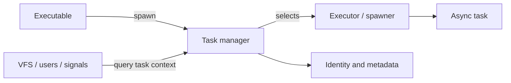
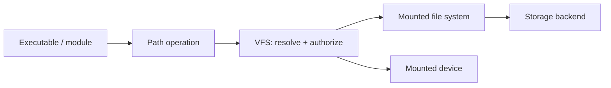
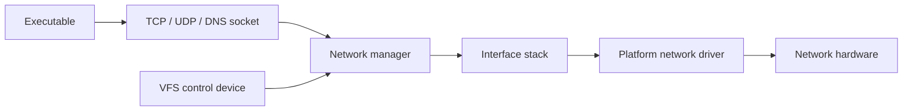

# Explanation accessibility design

Date: 2026-10-17
Status: proposed
Scope: `Xila-Project/website`

## Goal

Make Xila's Explanation documentation easier to understand for two audiences at the same time:

- developers who know Rust, operating-system concepts, async runtimes, and embedded systems but are new to Xila;
- generalist developers who may need a short mental model before implementation details become useful.

The redesign must preserve the technical depth of the current documentation while making the first 30–60 seconds of each page sufficient to understand the component's purpose, place in Xila, and main design idea.

The work must continue to follow Diátaxis. Explanation pages explain concepts, relationships, design choices, and trade-offs. Procedures belong in How-to or Tutorial content. Exhaustive API facts and lookup-oriented details belong in Reference or generated Rust documentation.

## Problem statement

The current architecture pages are technically rich but often expose implementation detail before the reader has a useful mental model. Repeated structures such as `Role in system`, `Responsibilities and boundaries`, `Internal architecture`, `Lifecycle`, `Data/control flow`, `Concurrency`, `Failure semantics`, and `Extension points` make pages complete, but they also make them read like internal engineering inventories.

Several introductory Mermaid diagrams mirror implementation structure rather than the conceptual relationship a new reader needs first. For example, names such as `StackInner`, `RwLock`, internal maps, or executor-specific objects can appear before the reader understands the simpler architectural relationship between an executable, a Xila service, a backend, and the platform.

The documentation already has useful `HostReference`, `GuestReference`, `DocsRsReference`, and `CodeReference` components, but Explanation pages mostly use them as end-of-page references. This misses an opportunity to connect concepts to precise Rust API symbols at the point where those concepts are introduced.

## Design principles

### 1. Progressive disclosure

Each Explanation page should move from conceptual understanding toward implementation detail.

The preferred cognitive order is:

1. what the component is and what problem it solves;
2. a concise mental model;
3. how it fits into the rest of Xila;
4. one concrete, non-procedural scenario that illustrates the flow;
5. the key API concepts that embody the design;
6. implementation details under an explicit deeper section;
7. trade-offs, boundaries, and limitations;
8. links to API reference, source, related explanations, and task-oriented documentation.

This is a pattern, not a mandatory heading template. Pages may omit or merge sections when doing so improves clarity.

### 2. Diátaxis boundaries

Explanation content answers questions such as:

- Why does this component exist?
- What responsibility does it own?
- How does it relate to other parts of Xila?
- Why is the architecture shaped this way?
- What trade-offs follow from the design?

Explanation content must not become a disguised how-to guide. A concrete scenario is descriptive, not imperative. For example, a VFS page may explain what happens when an executable opens `/data/config.json`, but it should not become a numbered procedure for opening files or mounting a backend.

Likewise, Explanation pages should not duplicate exhaustive reference material. Complete flag lists, error inventories, command tables, function signatures, and exact option matrices belong in Reference or Rustdoc. Explanation may mention a small number of representative errors or APIs only when they illuminate an architectural behavior.

### 3. Human-first diagrams

Mermaid remains the default diagram format because it is versionable, text-based, and already supported by the site.

Introductory diagrams should follow these rules:

- one idea per diagram;
- usually 4–7 primary nodes;
- human-readable labels rather than Rust type names where possible;
- no lock/container implementation detail in the first diagram;
- arrows should express a clear relationship such as calls, delegates, owns, routes, polls, or backs;
- every diagram should be followed by a short explanation of what the reader should notice.

Use diagram types intentionally:

- `flowchart LR` for architectural relationships and ownership;
- `sequenceDiagram` for a concrete request/data journey;
- `stateDiagram-v2` only when lifecycle states are genuinely important.

A page may include a second, deeper diagram under an implementation-oriented section. That diagram may use concrete Rust names such as `Manager`, `StackInner`, `SocketSet`, `RwLock`, or executor spawners because the reader has already acquired the higher-level model.

### 4. Rustdoc as a precision layer

Explanation pages must remain understandable without leaving the page. Rustdoc links provide precision and discoverability, not the explanation itself.

Important types, traits, functions, and methods should be linked inline when first introduced. End-of-page links remain useful for crate-wide exploration.

Examples of suitable inline links include:

- a VFS explanation linking `FileSystemOperations` when explaining backend independence;
- a Task explanation linking the task manager or task identifier type when explaining identity;
- a Network explanation linking the manager/socket abstractions when explaining interface and socket ownership.

`CodeReference` should be used when reading an implementation or example materially improves understanding. It should not be used merely because a source file exists.

## Rustdoc reference component change

### Current limitation

`HostReference` and `GuestReference` can target a crate or a top-level Rustdoc page derived from `kind` and `symbol`, such as `struct.File.html` or `trait.FileSystemOperations.html`. They cannot explicitly target an associated method, constant, type, or other anchor on that page.

### Proposed API

Add an optional `member` prop to `HostReference`, `GuestReference`, and the shared `Reference` component.

Example:

```md
<HostReference
  crate="virtual_file_system"
  kind="struct"
  symbol="File"
  member="method.open"
/>
```

The generated website link must keep the Rustdoc fragment inside the encoded `path` query parameter, for example conceptually:

```text
/reference/host?path=virtual_file_system%2Fstruct.File.html%23method.open
```

After `URLSearchParams` decodes `path`, the reference viewer should load:

```text
https://documentation.xila.dev/host/virtual_file_system/struct.File.html#method.open
```

The existing `crate`, `kind`, and `symbol` behavior remains unchanged when `member` is absent.

`member` is intentionally a Rustdoc anchor string rather than a new taxonomy implemented by the website. This keeps the component small and compatible with anchors such as `method.*`, `associatedconstant.*`, `associatedtype.*`, and future Rustdoc anchor forms without duplicating Rustdoc's model.

Supplying `member` without a valid `kind` + `symbol` target is invalid and should fail consistently with the component's existing argument validation.

### Display text

The current automatic display name continues to identify the top-level symbol. When authors want human-oriented link text for a method or associated item, they should use the existing slot:

```md
<HostReference
crate="virtual_file_system"
kind="struct"
symbol="File"
member="method.open"

> opening a file</HostReference>
```

This avoids introducing complicated automatic formatting for arbitrary Rustdoc anchors.

### URL handling requirement

The outer `/reference/host` or `/reference/guest` page must not consume the Rustdoc member as its own URL fragment. The member fragment must survive inside the `path` query value until the iframe URL is built.

Implementation must verify the current `URLSearchParams` and iframe behavior and preserve `#member` when building `iframeSrc`.

### Validation

Anchor/path construction should be tested deterministically in repository code where practical. Validation must not depend on the external documentation host being reachable.

## Page structure pattern

A typical architecture Explanation page should approximate the following shape.

### Opening

A short answer to "what is this?" and "why does Xila need it?" using terminology understandable before implementation details are introduced.

### Mental model

One short analogy or conceptual framing when it genuinely helps. Analogies must remain technically faithful and should not be used when they introduce more ambiguity than they remove.

Example for VFS:

> Think of the VFS as a router for paths: it decides which mounted backend owns a path, applies Xila's access policy, then forwards the operation.

### Place in Xila

A simple conceptual diagram and a few paragraphs describing neighboring components and boundaries.

### Concrete scenario

Describe one realistic interaction in narrative form. This is not a task guide.

Example:

> When an executable opens `/data/config.json`, it does not talk directly to LittleFS. The VFS resolves the mount that owns `/data`, evaluates permissions using the caller context, then delegates the operation through the file-system contract to the mounted backend.

A `sequenceDiagram` may accompany the narrative when it makes the journey easier to understand.

### Key API concepts

Introduce only the small set of Rust abstractions required to connect the explanation to the implementation. Link them inline with `HostReference` or `GuestReference`.

This section explains what the abstractions represent, not every method they expose.

### Under the hood

Preserve relevant current implementation detail here. This is the correct place for concrete collections, lock choices, reference-count strategies, runner/waker behavior, and internal ownership.

Implementation details should be labeled as such so readers do not mistake them for stable architectural contracts.

### Trade-offs and boundaries

Explain consequences rather than inventorying every unsupported API. Important limitations remain when they affect the mental model or design trade-off. Exhaustive limitations or exact unsupported-operation lists should move or link to Reference where appropriate.

### Explore further

Prefer a small, deliberate set of links:

- crate-level `HostReference` or `GuestReference`;
- relevant symbol-level Rustdoc links;
- one or two useful `CodeReference` links;
- neighboring Explanation pages;
- relevant How-to or Reference pages when the reader's next question changes category.

## Example transformations

### Task

Current pages expose task metadata maps, spawner maps, and executor internals early.

The revised mental model should explain first that Xila needs a logical task identity independent of the executor that runs a future. The task manager owns that identity and metadata, while registered executors/spawners perform the actual execution.

Suggested introductory diagram:



The current `BTreeMap` and `RwLock` details remain available under `Under the hood`.

### Virtual file system

The revised page should first establish the VFS as the namespace and policy layer between callers and heterogeneous mounted backends.

Suggested introductory diagram:



A later sequence diagram can show the conceptual journey of opening one path. Internal mount registries, reference counts, and locks remain deeper in the page.

### Network

The revised page should first explain that each network interface combines a protocol stack with a platform network device, while Xila exposes sockets to applications and control operations through the VFS.

Suggested introductory diagram:



A deeper diagram may then introduce runner polling, `SocketSet`, wake signals, and internal synchronization.

### Memory

The revised page should first explain that Xila separates allocation policy from the rest of the system through an allocator contract, while also adapting that allocator to Rust's global allocation path.

The first diagram should distinguish callers, the memory abstraction, and the platform allocator. Capability flags, cache hooks, ABI mutexes, and backend algorithms belong deeper in the page.

## First implementation wave

The first PR should intentionally be limited to pages that establish the documentation style and Xila's core mental models:

- `src/explanation/index.md`
- `src/explanation/architecture/index.md`
- `src/explanation/architecture/components.md`
- `src/explanation/architecture/modules/index.md`
- `src/explanation/architecture/modules/task.md`
- `src/explanation/architecture/modules/memory.md`
- `src/explanation/architecture/modules/network.md`
- `src/explanation/architecture/modules/virtual_file_system.md`

Supporting implementation may touch:

- `.vitepress/theme/components/HostReference.vue`
- `.vitepress/theme/components/GuestReference.vue`
- `.vitepress/theme/components/Reference.vue`
- `.vitepress/theme/utilities/reference.ts`
- `src/how-to/write-documentation.md`
- `AGENTS.md` if a concise authoring rule is required for future agent consistency.

The exact supporting-file set should remain minimal and follow the existing component architecture.

## Out of scope for the first wave

- rewriting every module, crate, driver, and executable Explanation page;
- adding interactive architecture visualizations;
- replacing Mermaid with a custom diagram system;
- changing generated Rustdoc itself;
- changing Xila Core behavior or APIs;
- adding broad new reference pages solely to relocate small amounts of text;
- turning Explanation pages into tutorials or task guides.

Once the first wave is reviewed, a second PR may apply the validated pattern to the remaining architecture pages more mechanically.

## Content migration rules

The rewrite must preserve useful technical information rather than deleting detail for the sake of simplicity.

When existing content is too reference-like for Explanation:

1. keep it if it materially explains a design boundary or trade-off;
2. otherwise link to an existing Reference/Rustdoc location when one already covers it;
3. create new Reference content only when the information is important, currently unique, and would otherwise be lost;
4. avoid duplicating the same authoritative table or exact fact in both Explanation and Reference.

When implementation detail is still valuable, move it lower in the same page under a clearly implementation-oriented section rather than removing it.

## Documentation authoring guidance

The repository's documentation guide should be updated with a concise Explanation-specific rule set:

- begin with a mental model before internals;
- explain relationships and rationale rather than procedures;
- use diagrams to teach one concept at a time;
- link important Rust symbols inline;
- move exhaustive lookup data toward Reference;
- preserve implementation detail under a deeper section when it helps maintainers and advanced readers.

This guidance should remain compatible with the existing Diátaxis templates rather than creating a separate parallel documentation system.

## Validation strategy

### Repository validation

The final implementation must pass the existing repository checks:

```sh
npm ci
npm run check
git diff --check
```

`npm run check` remains the source of truth for formatting, production VitePress build, Pagefind generation, and documentation metadata/link/anchor validation.

### Reference component validation

The implementation should add or use the narrowest practical deterministic validation for Rustdoc URL construction, covering at minimum:

- existing crate-only link behavior;
- existing top-level `kind` + `symbol` behavior;
- a top-level symbol with `member="method.open"`;
- correct host versus guest reference paths;
- behavior when `member` is supplied without a valid top-level symbol target.

No test should require network access to `documentation.xila.dev`.

### Editorial validation

Review each rewritten page against these questions:

- Can a new Xila reader explain the component's purpose after the opening section and first diagram?
- Does the first diagram teach a concept rather than mirror Rust structs?
- Does the page remain useful to an experienced Rust developer who wants implementation detail?
- Are procedures routed to How-to/Tutorial instead of embedded in Explanation?
- Are exhaustive facts routed to Reference/Rustdoc instead of duplicated?
- Are Rustdoc links contextual and precise?
- Were existing technical facts either preserved, deliberately relocated, or intentionally removed with a clear reason?

## Success criteria

The first wave is successful when:

- the introductory architecture and selected module pages follow progressive disclosure without feeling mechanically templated;
- a reader can understand each selected component's role and relationships before encountering internal Rust data structures;
- introductory diagrams are simple and human-oriented;
- deeper implementation detail remains available;
- important Rust API concepts are linked inline to precise generated documentation;
- the new `member` reference capability works for host and guest Rustdoc links without breaking existing links;
- Diátaxis boundaries remain explicit and consistent;
- all repository checks pass;
- the resulting pages provide a clear pattern for a later second-wave migration.

## Risks and mitigations

### Oversimplification

Risk: introductory text or diagrams may hide constraints that materially affect the architecture.

Mitigation: preserve a deeper implementation section and review existing facts during migration rather than rewriting from memory.

### Explanation/reference duplication

Risk: attempts to make pages complete may reproduce large API inventories.

Mitigation: treat Rustdoc and Reference as the precision layer and keep Explanation focused on why and how concepts relate.

### Mechanical page uniformity

Risk: forcing identical headings across every page can make documentation repetitive and awkward.

Mitigation: standardize the cognitive order, not the exact heading set.

### Rustdoc anchor fragility

Risk: associated-item anchors are generated by Rustdoc and may change across toolchain behavior.

Mitigation: keep `member` as an explicit anchor string, avoid reimplementing Rustdoc semantics, and make broken-link behavior easy to identify during review. The website should not promise anchor stability beyond generated Rustdoc behavior.

### Scope expansion

Risk: rewriting selected pages may reveal missing Reference content and grow into a full documentation migration.

Mitigation: only create supporting Reference content when necessary to avoid losing important unique information. Defer the remaining architecture pages to a second wave.
