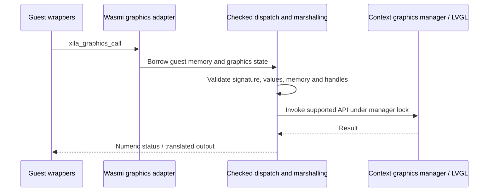

# Bindings

Xila's graphics bindings connect guest WebAssembly imports to the context-provided graphics manager. The shared LVGL catalog is generated in `subsystems/graphics/bindings_generator`; host dispatch and the Wasmi adapter live in `executables/wasm/src/host/graphics`.

## Architecture and ownership

- `graphics_bindgen` discovers and orders the shared catalog. A build-time support registry filters guest wrappers and host metadata to implemented calls without renumbering legacy IDs; unsupported calls retain catalog IDs but are not generated as guest APIs. The registry emits a build-only JSON ABI inventory in `OUT_DIR`.
- Guest wrappers import `xila_graphics_call`; `default_guest` also emits C wrappers and `xila_graphics.h` in the build output directory. Generation does not rewrite guest source files.
- `dispatch`, `objects`, and `marshal` use explicit graphics state and checked borrowed memory, without Wasmi types or global graphics-manager lookup.
- `graphics/wasmi.rs` handles store/memory access, import registration, and context capability checks.
- VM-local object handles represent host objects. Deletion invalidates handles; issued handles are not reused within an execution. Teardown removes owned windows and children, including after traps.
- Retained button-map strings and pointer tables are copied into VM-owned storage; guest memory growth or mutation cannot invalidate them. Label strings are copied synchronously by LVGL.

## Compatibility and supported calls

The catalog requires guest and host bindings built from the same LVGL revision and configuration; call IDs are not a stable cross-version graphics ABI. Core now uses LVGL 9.6, including its updated event codes.

Calculator exercises the supported graphics subset; Weather still requires calls beyond it. The [graphics reference](/reference/graphics-bindings#supported-calls) lists the exact operations and compatibility requirements.

Calls involving arbitrary native structure layouts, guest callbacks, retained guest pointers, raw LVGL fonts/styles, raw image assets or other unsupported LVGL functions are not offered as safe guest wrappers. **Bounded Chart and Line widget adapters are now supported**, with host-owned typed data rather than native guest pointers. Unsupported numeric IDs still return an unsupported status. Guest memory is never interpreted as a typed host reference.

## Extended widget surface (Core #488 and #489)

The generated host-dispatched graphics surface now contains **133 calls** (out of 1,088 surveyed catalog calls in this configuration). Range/toggle adapters include Arc, Bar, Slider, Switch and Spinner with checked values, ranges, orientation/state, and bounded animation parameters. The next slice adds Calendar, Spinbox, Chart, Line, List and Tileview along with Shadcn Badge/Card/button-variant/Input-error helpers.

Calendar highlights, Line points and Chart series data are host-owned. Chart series are scoped IDs rather than native pointers, and Tileview returns checked child handles. There is no unrestricted host heap or automatic guest-pointer retention: per-widget and per-VM budgets apply. However, this **does not** expose every enabled LVGL widget, arbitrary images or automatic ABI version negotiation. See [resource limits](/reference/graphics-bindings#resource-limits).

## Layout and semantic styling

The merged graphics ABI covers scalar object geometry, built-in Flex/Grid layouts, validated grid track arrays and cell placement, local RGB888 style properties, four semantic theme surfaces and six host-owned ROM font roles. Grid arrays are copied into host-owned allocations rather than retained in guest memory (31 tracks per axis, 512 retained descriptors per VM). A guest receives checked IDs instead of raw `lv_style_t` or `lv_font_t` pointers. This remains a partial LVGL surface; other widgets and ABI capability/version negotiation are follow-up work.

## Bounded state

Object handles and retained map strings have fixed limits so an execution's host-side state remains bounded. Handles are local to the VM and never reused during that execution; this prevents a deleted object's identity from granting access to a later object. The [reference](/reference/graphics-bindings#resource-limits) gives capacities and numeric status codes.

## Extension points and validation

Extend the shared catalog and checked dispatch together, and keep the Wasmi adapter thin. Validate memory and handle behavior before adding a supported call. Native adapter and lifetime tests exercise cleanup; the portable translation tests separately cover guest-memory boundaries and word widths.

## Exact boundary between generation and runtime

Graphics bindings are generated from a shared LVGL catalog in `subsystems/graphics/bindings_generator`, but **the Wasmi executable** owns guest memory translation, handle tables and host dispatch. A generated function ID is not an unrestricted LVGL function pointer. The generated host `Function` table contains signatures and supported-call metadata from the shared build-time registry; the guest and host must use matching LVGL versions and generated catalogs.

`host/graphics/wasmi.rs` installs exactly one graphics entrypoint under the import pair `("host", "xila_graphics_call")`. Each invocation supplies a function ID, **up to seven machine-word arguments**, the argument count and a result address. Before dispatch, the adapter checks that the current `ExecutableContext.graphics_manager` is the manager granted to that VM and obtains the current Wasmi linear memory view.

`dispatch` checks the function ID, expected argument count, result pointer, handle kinds and value domains, then takes the Graphics lock before calling supported LVGL operations. Missing graphics capabilities or unsupported calls return explicit numeric error statuses rather than granting direct host pointers.

## Memory, object and retained-string limits

The graphics bridge stores VM-local object capabilities in a bounded `GraphicsState`. It allows **256 object slots**, assigning monotonically increasing nonzero handles. Deletion invalidates the object without reassigning that handle to another object in the same VM. A graphics object is tied to a window tree; VM teardown deletes owned windows and releases retained maps/canvases.

`GuestMemory` decodes little-endian ABI values by value and validates address ranges with checked multiplication and addition. No Rust references into guest linear memory may survive a guest-memory growth or a host async suspension. Typed values are not reconstructed with unchecked host-native struct layout.

The current marshaller has explicit limits:

- **Object slots:** 256 per VM.
- **Ordinary NUL-terminated strings:** 1,024 bytes including the terminator.
- **Textarea strings:** 4,097 bytes including the terminator.
- **Button-map entries:** 64, counting the end sentinel.
- **Retained button-map storage:** 8,192 bytes including strings and sentinel.

Button-map strings and pointer arrays are **copied into stable VM-owned host storage** before LVGL retains them. Ordinary label text is copied synchronously by LVGL. Unsupported native callback pointers and arbitrary binary structure layouts remain outside the guest API.

## Extending safely

Add the function signature to the shared catalog, implement checked dispatch, then update the guest wrapper generation and tests. Preserve unsupported IDs when changing the catalog to avoid accidental renumbering, but **do not promise binary compatibility across independently built LVGL revisions**.

Run host-side object deletion tests and guest memory32/memory64 translation tests; verify handle invalidation, bad pointer rejection, event-queue cleanup and resource-cap enforcement before considering a new binding supported.

### Source references

- <CodeReference path="subsystems/graphics/bindings_generator" /> — API catalog and function selection.
- <CodeReference repo="applications" path="executables/wasm/src/host/graphics/wasmi.rs" /> — Wasmi import registration.
- <CodeReference repo="applications" path="executables/wasm/src/host/graphics/dispatch.rs" /> — checked host dispatch.
- <CodeReference repo="applications" path="executables/wasm/src/host/graphics/objects.rs" /> — VM-local object registry.
- <CodeReference repo="applications" path="executables/wasm/src/host/graphics/marshal.rs" /> — retained strings and map bounds.
- <CodeReference repo="applications" path="executables/wasm/src/host/translation/memory.rs" /> — borrowed guest-memory view.
- [Bindings reference](/reference/graphics-bindings) — supported call list and status codes.

## References / See also

- <CodeReference path="subsystems/graphics/bindings_generator" />
- <CodeReference repo="applications" path="executables/wasm/src/host/graphics" />
- <CodeReference repo="applications" path="executables/wasm/tests/translation/README.md" />
- <HostReference repo="applications" crate="wasm" />
- [Graphics](/explanation/architecture/subsystems/graphics)
- [WASM runtime](/explanation/architecture/executables/wasm)
- [ABI](/explanation/architecture/libraries/abi)
