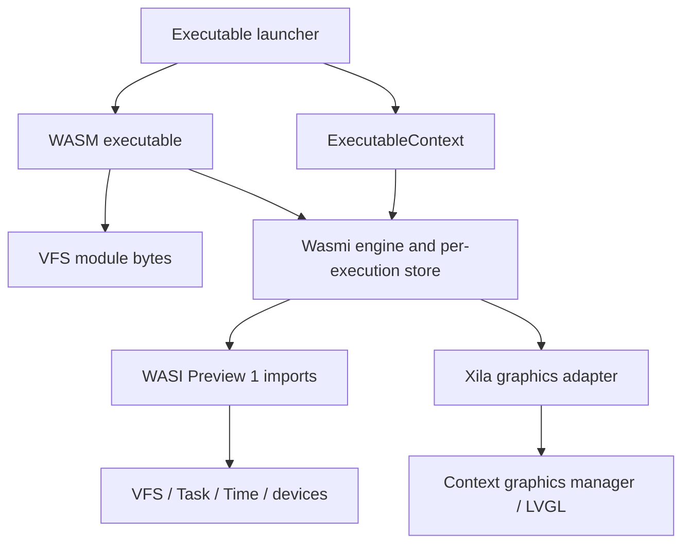

# Virtual machine

Xila's WebAssembly runtime lives in `executables/wasm` and uses the Wasmi interpreter. The `host` feature means Xila hosts guest programs; it also works when Xila itself runs in a browser. The previous WAMR integration and `Runtime::execute` API have been removed.

## Responsibilities and boundaries

- Load a regular file from Xila's VFS and validate its WebAssembly module.
- Create a Wasmi engine, linker, module, and store for each execution.
- Register WASI Preview 1 imports and optional Xila graphics imports.
- Invoke `_start: () -> ()`, or `__install: () -> ()` with `--install`.
- Cooperatively yield, suspend, and resume the guest without holding guest-memory borrows across an await.

This layer does not provide full WASI coverage or direct hardware access. Its capabilities come from the caller's `ExecutableContext`.

## Internal architecture

- `host/main.rs`: argument parsing, VFS loading, engine/linker construction, and entrypoint selection.
- `host/store.rs`: per-execution `GlobalStore` holding the executable context, pending suspension, WASI state, and optional graphics state.
- `host/execution.rs`: resumable Wasmi calls, fuel replenishment, yield handling, clock waits, and exit/error propagation.
- `host/wasi/`: file/directory descriptors, environment and arguments, clocks, random data, process exit, and supported polling imports.
- `host/translation/`: checked borrowed guest-memory access and pointer/word-width conversion.
- `host/graphics/`: runtime-independent dispatch, object handles, and marshalling, plus a thin Wasmi adapter.

## Lifecycle and execution model

1. Read guest bytes and create a fuel-enabled engine and module.
2. Build a store from `Standard::context`; install stdin/stdout/stderr as descriptors 0/1/2 and preopen `/` if available.
3. Copy the task environment and use the module path as the guest argument.
4. Register WASI and optional graphics imports, instantiate the module, then select a typed entrypoint.
5. Execute resumably; on fuel exhaustion, yield and replenish fuel. `sched_yield` suspends locally; supported `poll_oneoff` clock calls wait asynchronously before resuming.
6. Propagate exit status or traps and tear down execution state, including owned graphics windows.

## Scheduling and limits

- The instruction quantum controls fuel replenishment between yields rather than a total lifetime instruction budget.
- Clock polling supports realtime/startup clocks with relative or absolute deadlines. File-descriptor polling and unsupported clocks return errors.
- Startup-clock behavior follows Xila's time manager and its driver; it is not a separate hardware monotonic source.
- Suspension in a WebAssembly start section is unsupported. WASI command guests should use exported `_start`.
- The stack-size option is parsed but is not applied by the runtime.
- `memory_32` is the default guest-word width; `memory_64` selects the alternate translation configuration. Calculator remains a wasm32 guest.
- Graphics capabilities cover the supported subset documented in [Bindings](/explanation/architecture/executables/bindings); enabling graphics does not provide every LVGL API.

The [runtime reference](/reference/wasm-runtime#execution-limits) is the authoritative lookup page for option defaults and polling capacities.

## References / See also

- <CodeReference path="executables/wasm" />
- <HostReference crate="wasm" />
- [WASM executable](/explanation/architecture/executables/wasm)
- [Bindings](/explanation/architecture/executables/bindings)
- [ABI](/explanation/architecture/libraries/abi)
