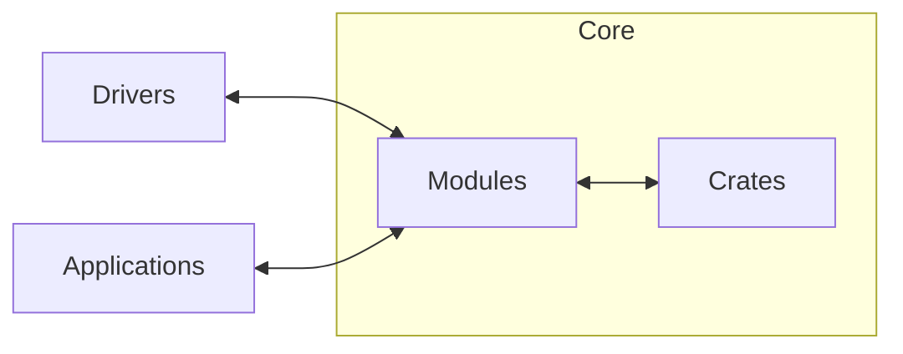

# 📐 Architecture

Xila is designed with modularity and portability in mind. It is built to run on a variety of platforms, from embedded systems to desktop computers, and even in web browsers via WebAssembly (WASM).

Use the [component map](./components) to find a module, crate, driver, or executable together with its related task guides and reference.

- [Drivers](/explanation/architecture/drivers/): Xila supports a wide range of hardware drivers, allowing it to interface with various peripherals and devices.
- [Crates](/explanation/architecture/crates/): Internal libraries, or "crates", provide essential functionalities that can be leveraged by modules and applications.
- [Modules](/explanation/architecture/modules/): Stateful crates providing core services through explicitly constructed managers and references passed by the final binary.
- [Executables](/explanation/architecture/executables/): User programs that run on top of Xila, either as native binaries or as WASM modules.

Xila itself is implemented as a library, which means that applications can directly link against it. This design choice allows for greater flexibility and ease of use, as developers can build applications that leverage Xila's capabilities without the need for a traditional operating system layer.

It's only in the end binary that Core, Drivers and Applications are assembled together to create a complete system.

## Runtime assembly

The final binary owns the task, users, time, VFS, graphics, and optional network managers. It constructs them in dependency order and passes references to consumers. Constructors such as `task::Manager::new()`, `users::Manager::new()`, and `time::Manager::new(driver)` replace production singleton lookups.

`executable::ExecutableContext` carries these references into mounted executables; `Standard::context` makes the same capabilities available during execution. Authentication operations receive an `authentication::Context` with managers and a task identifier. See <CodeReference path="examples/native/src/main.rs" /> and <CodeReference path="examples/wasm/src/main.rs" /> for complete assembly.

Some global boundaries remain: the allocator, logger, C ABI `RuntimeContext`, and LVGL callbacks. Explicit manager ownership does not make the process-global LVGL runtime support multiple independent displays/runtimes.
