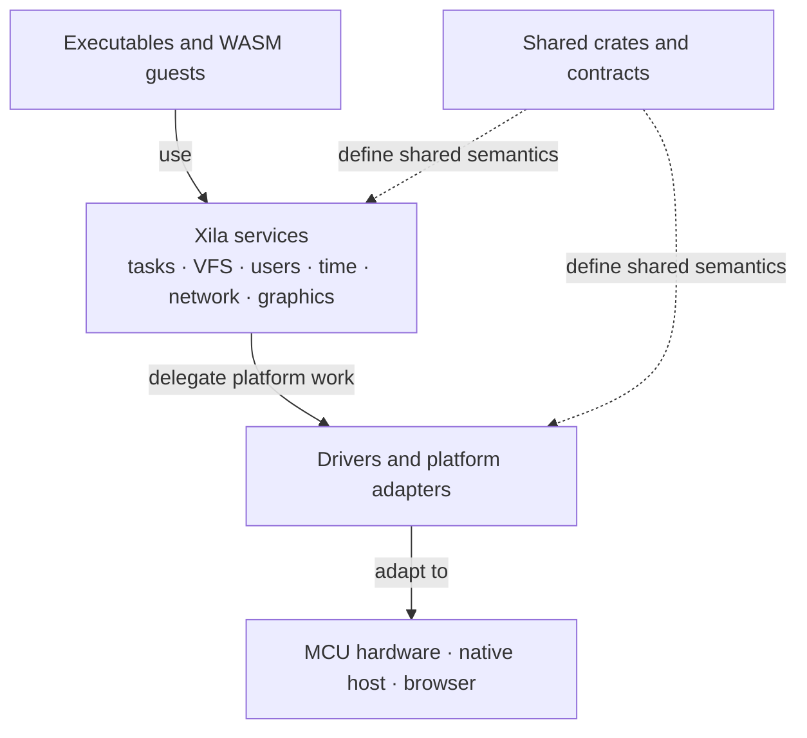
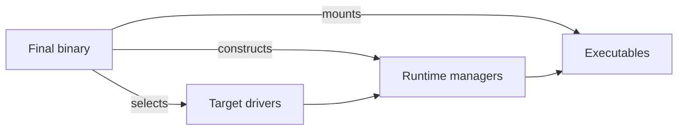

# Architecture

Xila is not built around one fixed hardware platform or one monolithic system image. Its core is a set of Rust services and contracts that the final binary assembles with target-specific drivers and the executables it wants to expose.

That assembly model is what lets the same architecture stretch from microcontrollers to a native desktop process and a browser-hosted WebAssembly demonstration.

## Mental model

Think of Xila as four layers that meet in the final binary:

The important distinction is between **what Xila means** and **how a target provides it**. Services such as the virtual file system or task manager expose system behavior. Shared crates define contracts and reusable types. Drivers adapt those contracts to concrete hardware or host facilities. Executables sit above those services and consume the resulting runtime.

## Assembly happens at the edge

Xila Core is implemented as a library. A final binary decides which concrete pieces exist, constructs the stateful managers it needs, and passes references between them.

This keeps ownership explicit. The task manager, users manager, time manager, VFS, graphics manager, and optional network manager are not discovered through a universal runtime registry in production code; the binary creates them in dependency order and gives each consumer the capabilities it needs.

Mounted executables receive those capabilities through <HostReference crate="executable" kind="struct" symbol="ExecutableContext" />, while the executable runtime carries the same context through execution. This is why a native example, an embedded target, and a browser host can share most of the same services while assembling different drivers around them.

The first diagram explains the architectural layers; this second one shows who actually owns the runtime. Xila does not hide that ownership behind a traditional kernel boot boundary.

## Why separate services from drivers?

Portability depends on keeping platform-specific mechanisms out of the architectural contracts. A network service should reason about interfaces and sockets without knowing whether packets ultimately travel through an ESP32 peripheral, a native host adapter, or a browser bridge. The same idea applies to storage, time, graphics, and other platform-facing capabilities.

The separation is not absolute. Some facilities are inherently process-wide, and some integrations still cross architectural layers. The point is to make those boundaries visible rather than pretend every subsystem is interchangeable.

## How the documentation names the pieces

- [Modules](/explanation/architecture/modules/) are the stateful runtime services and module-adjacent execution boundaries that make up the running system.
- [Crates](/explanation/architecture/crates/) contain shared contracts, data models, helpers, and supporting runtime logic.
- [Drivers](/explanation/architecture/drivers/) adapt Xila to a concrete target or host environment.
- [Executables](/explanation/architecture/executables/) are programs exposed through the executable runtime, including native components and WebAssembly guests.

Use the [component map](./components) when you know roughly what part of the system you are looking for but not which page owns it.

## Runtime assembly

Most stateful services are explicitly owned by the final binary, but a few boundaries remain process-global because of the external interfaces they integrate with. The allocator and logger are global integration points; the C ABI installs a runtime context; LVGL callbacks also cross into process-wide runtime state.

That means explicit manager ownership should not be read as a promise that multiple completely independent Xila runtimes can always coexist inside one process. In particular, the current LVGL integration remains a global boundary rather than an isolated per-runtime display stack.

For concrete assembly code, compare <CodeReference path="examples/native/src/main.rs" /> and <CodeReference path="examples/wasm/src/main.rs" />. They are implementation examples of the ownership model described here, not a separate architecture.

## Explore further

- [Component map](./components) — find a service, contract, driver, or executable.
- [Modules](/explanation/architecture/modules/) — understand the major runtime services.
- [Development environments](/explanation/development-environments) — understand how the target/toolchain boundary changes across platforms.
- [Host API](/reference/host) — look up exact host-side Rust interfaces once you need reference detail.
