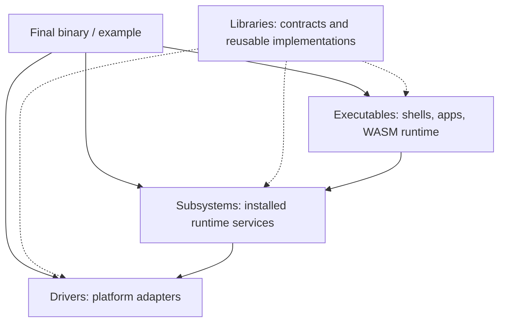

# Architecture

Xila is a collection of portable Rust crates assembled into a runtime by a target-specific final binary. The source layout names each component by its **architectural role**, not by whether Cargo considers it a crate (all four categories contain crates).

## Component roles

- [Subsystems](/explanation/architecture/subsystems/) own or coordinate Xila runtime capabilities such as tasks, the VFS, graphics, networking, users and time.
- [Libraries](/explanation/architecture/libraries/) provide contracts, types, algorithms, protocols, adapters or implementations; having internal state does not automatically make one a subsystem.
- [Drivers](/explanation/architecture/drivers/) connect generic contracts to ESP32, native, browser and other target facilities.
- [Executables](/explanation/architecture/executables/) consume the assembled runtime, including shells, applications and the Wasmi guest execution boundary.

This is a responsibility map, **not a prohibition on legitimate cross-crate dependencies**. For instance, executable helpers in `libraries/executable` use subsystem managers, but they do not own an independently installed service.

## Runtime assembly

A final binary creates the managers and drivers needed for its target, assembles their dependencies, and passes references to consumers. Mounted executables receive those capabilities through <HostReference crate="executable" kind="struct" symbol="ExecutableContext" />. This model works for embedded hardware, native processes and browser-hosted WASM.

Some external integrations are necessarily process-global: the Rust allocator and logger, C ABI registration and LVGL callbacks. These exceptions do not imply a universal runtime singleton or guarantee that multiple independent Xila runtimes can coexist in one process.

ABI declarations/definitions belong under [Libraries](/explanation/architecture/libraries/abi). Guest/host bindings and the Wasmi interpreter belong with [Executables](/explanation/architecture/executables/wasm), not standalone subsystems.

For real assembly examples, see <CodeReference path="examples/native/src/main.rs" /> and <CodeReference path="examples/wasm/src/main.rs" />.

## API reference

Browse the <HostReference crate="xila">host Rustdoc</HostReference> for native and runtime APIs, or the <GuestReference crate="xila">guest Rustdoc</GuestReference> for WebAssembly guest-facing APIs. Individual component pages link directly to their crate documentation.

## Explore

Start with the [component map](./components), then the [subsystem](/explanation/architecture/subsystems/), [library](/explanation/architecture/libraries/), [driver](/explanation/architecture/drivers/) or [executable](/explanation/architecture/executables/) catalog.
