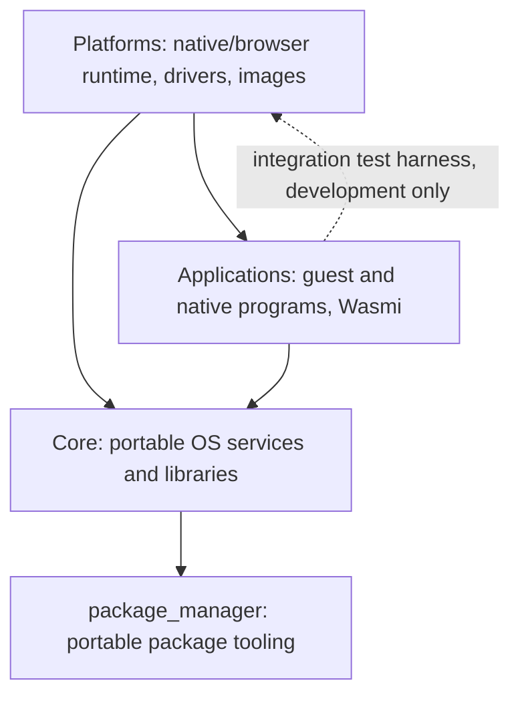

# Architecture

Xila is assembled from **three independently versioned Rust workspaces**, plus separate shared [package tooling](/explanation/package-management). Their distinction is by **repository ownership and dependency direction**, not whether a crate happens to be an application or uses `no_std`.

## Repository ownership

- **[Core](https://github.com/xila-project/core)** contains reusable subsystem managers (Task, VFS, Graphics, Time, Network, Users, Memory, Log), general device/filesystem/ABI libraries, and its `xila` API façade under <CodeReference path="core/src/lib.rs" />.
- **[Applications](https://github.com/xila-project/applications)** contains the Wasmi host interpreter, guest API and six bundled WASI apps, plus graphical shell, CLI shell, Settings, file manager, Terminal and other native executables.
- **[Platforms](https://github.com/xila-project/platforms)** contains target drivers, the integration/testing harness, the Linux/OCI and browser final binaries, filesystem seed builders and the actual browser-demo CI.
- **[package_manager](https://github.com/xila-project/package_manager)** and **[packages](https://github.com/xila-project/packages)** own separate experimental package tooling and publication metadata, not installed runtime services.

Production dependency direction is **Platforms → Applications → Core**, with Platforms also directly depending on Core. Development-only test harness imports may reverse these edges; no circular production runtime ownership is intended. Git dependencies are pinned and local code overrides need explicit Cargo configuration.

## Portable architecture roles

Core's [subsystems](/explanation/architecture/subsystems/) own runtime capabilities and lifecycle. [Libraries](/explanation/architecture/libraries/) expose contracts, protocols and reusable implementations. [Drivers](/explanation/architecture/drivers/) mostly live in Platforms except Core's minimal `drivers/core` implementations. [Executables](/explanation/architecture/executables/) live in Applications.

A final **Platforms** runtime builds the required managers, drivers and executable contexts for its target and mounts the VFS devices and applications. See <CodeReference repo="platforms" path="examples/native/src/main.rs" /> and <CodeReference repo="platforms" path="examples/wasm/src/main.rs" /> for the actual composition.

The global allocator, logger and C/LVGL callbacks can still require process-global registration; portable manager APIs themselves need not be singletons.

## Docs and demonstrations

Core's <CodeReference path=".github/workflows/pages.yml" /> publishes **host Rustdoc only**. The [Host API](/reference/host) embeds those docs. The [Guest API](/reference/guest) points to Applications source because that Rustdoc is not currently published under the old Core Pages `/guest/` location.

Platforms' <CodeReference repo="platforms" path=".github/workflows/demo.yml" /> publishes [the browser demo](https://platforms.xila.dev/) including localized routes under `/demonstrations/wasm/<locale>/`. For runtime details see [development environments](/explanation/development-environments).

## Find a component

- [Component map](./components) — responsibilities of each role.
- [Subsystems](./subsystems/) — Core service managers.
- [Libraries](./libraries/) — portable contracts.
- [Drivers](./drivers/) — Core minimal drivers and Platforms-specific drivers.
- [Executables](./executables/) — official Applications and Wasmi.
