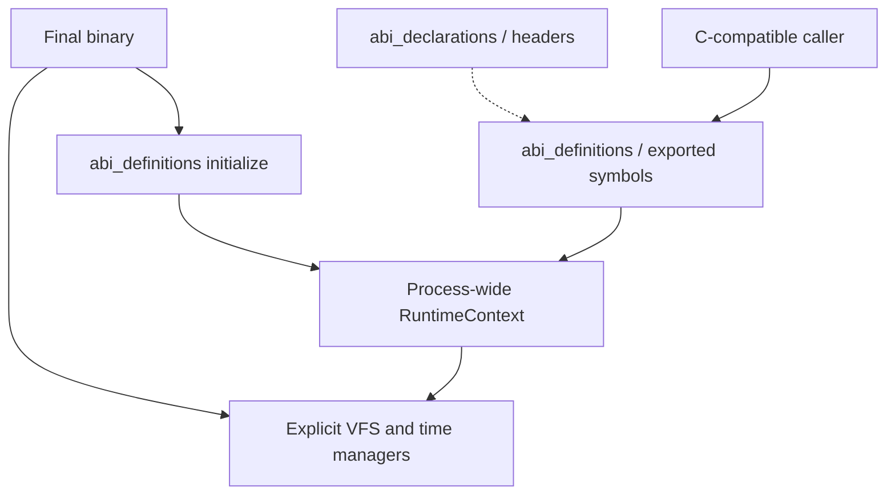

# ABI

Xila's C ABI surface is split between declarations and symbol definitions. Rust services use explicit managers; C entrypoints receive their VFS and time capabilities through a separately installed process-wide runtime context.

## Responsibilities and boundaries

- Export C-compatible signatures, types, constants, and numeric result conventions.
- Adapt raw pointers and identifiers to Xila's file, memory, task, and time APIs.
- Keep declarations/header generation separate from concrete exported symbols.

Coverage remains incremental. This ABI is distinct from the Wasmi runtime's local WASI and graphics imports; it is not a claim of full WASI compatibility.

## Internal architecture

- <HostReference crate="abi_declarations" />: C declarations and generated header surface.
- <HostReference crate="abi_definitions" />: exported `#[unsafe(no_mangle)] extern "C"` functions, types, and service adapters.
- `abi_definitions::RuntimeContext`: static VFS/time references stored once for C entrypoints.

The old `abi_context` crate and its `Context::call_abi` path are not part of the current workspace. Wasmi keeps file descriptors and active task information in its own per-execution `WasiContext`.



## Lifecycle and execution model

1. The final binary constructs the managers and VFS and keeps them alive.
2. It calls `abi_definitions::initialize(RuntimeContext { virtual_file_system, time_manager })` before C ABI use.
3. Exported functions obtain this runtime context and dispatch through its references. File/directory entrypoints that require task identity accept it in their C arguments.
4. Synchronous boundaries use synchronous VFS wrappers or `task::block_on` where required.

Registration uses `OnceLock`: the first context remains installed for the process. Calling a context-dependent entrypoint before registration panics. This is an intentional global FFI boundary, not the production lifecycle of every Rust module.

## Concurrency and failure semantics

- Module locks and ABI-local synchronization protect the operations they own.
- Success is generally zero; nonzero codes map service errors at the C boundary.
- Invalid pointers/identifiers must be checked at conversion boundaries.
- Several exported functions remain `todo!()`; inspect the symbol implementation before depending on it.

## Extension points

Extend definitions and declarations together, regenerate headers, and preserve signature/layout/error-code compatibility. Use explicit Rust manager references inside services and confine runtime-context access to the C boundary.

## Concrete FFI contract

`abi_declarations` uses generated declarations from `OUT_DIR/declarations.generated.rs`; the public header is maintained in `libraries/abi/xila.h`. `abi_definitions` exports the actual symbols and their adapters, grouped into file-system, memory, string, task, time and user families. The declaration and definition crates must evolve together so C integer widths, pointer mutability, structures and command identifiers remain compatible.

A final binary installs `RuntimeContext` once. The context contains `&'static virtual_file_system::VirtualFileSystem` and `&'static time::Manager<'static>`, so the binary must keep both alive for the lifetime of any C caller. Subsequent calls to `initialize` do not replace the first context. Calls to context-dependent exported functions before that initialization panic.

```rust
abi_definitions::initialize(abi_definitions::RuntimeContext {
    virtual_file_system: vfs,
    time_manager: clock,
});
```

Here, `vfs` and `clock` are already constructed `'static` references. This is **process-wide FFI wiring**, not a replacement for passing explicit managers to native Rust libraries.

## ABI stability and incomplete operations

- **Pointer and layout safety:** raw C memory must be validated against each exported function's contract. A safe wrapper cannot infer buffer lengths or lifetimes from an arbitrary pointer.
- **Return conventions:** check each exported symbol's numeric error mapping before treating an integer return as a Rust `Result`; not every category has identical return types.
- **Task identity:** VFS-facing C functions may require an explicit logical task ID, which is not equivalent to the Wasmi guest's per-execution descriptor table.
- **Incomplete coverage:** unimplemented `todo!()` functions remain in the ABI tree; the existence of a header declaration does not imply a usable implementation.
- **Compatibility:** the file-system ABI and Wasmi host imports are separate surfaces and should be tested independently.

### Source and API details

- <CodeReference path="libraries/abi/declarations/src/lib.rs" /> — generated declarations entry point.
- <CodeReference path="libraries/abi/xila.h" /> — C header.
- <CodeReference path="libraries/abi/definitions/src/lib.rs" /> — runtime context and exported families.
- <HostReference crate="abi_definitions" kind="struct" symbol="RuntimeContext" /> — C runtime capabilities.


## References / See also

- <CodeReference path="libraries/abi/definitions/src/lib.rs" />
- <HostReference crate="abi_declarations" />
- <HostReference crate="abi_definitions" />
- [Virtual file system](/explanation/architecture/subsystems/virtual_file_system)
- [Bindings](/explanation/architecture/executables/bindings)
- [WASM runtime](/explanation/architecture/executables/wasm)
