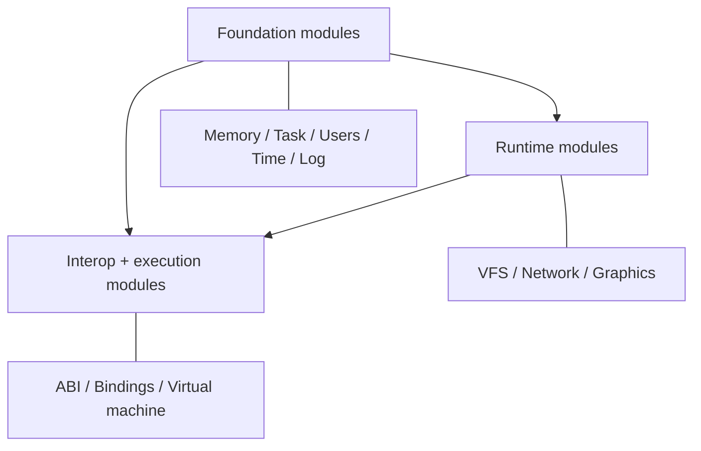

# Modules

Xila is organized as composable modules with explicit contracts and concrete implementations. The final binary constructs stateful managers and passes references to other modules and executables. Lock-protected state belongs to those managers; allocator, logging, C ABI, and LVGL callback boundaries retain process-wide registration.

This section is an architecture map, grouped by system role.

## Recommended reading order

1. [Virtual file system](/explanation/architecture/modules/virtual_file_system)
2. [Task](/explanation/architecture/modules/task)
3. [Network](/explanation/architecture/modules/network)
4. [ABI](/explanation/architecture/modules/abi)
5. [Bindings](/explanation/architecture/modules/bindings) (runtime integration path)
6. Remaining modules and integrations: [Memory](/explanation/architecture/modules/memory), [Users](/explanation/architecture/modules/users), [Time](/explanation/architecture/modules/time), [Log](/explanation/architecture/modules/log), [Graphics](/explanation/architecture/modules/graphics), [Virtual machine](/explanation/architecture/modules/virtual_machine)

## Foundation modules

- [Memory](/explanation/architecture/modules/memory): Allocation contract (`ManagerTrait`), global allocator bridge, capability flags, and cache/page helpers.
- [Task](/explanation/architecture/modules/task): Manager-owned task registry, executor/spawner integration, metadata inheritance, and signal delivery.
- [Users](/explanation/architecture/modules/users): In-memory user/group database and identifier/membership resolution.
- [Time](/explanation/architecture/modules/time): Explicit time source abstraction over a direct character device.
- [Log](/explanation/architecture/modules/log): Global logging bridge (`LoggerTrait`) on top of `log` ecosystem integration.

## Runtime modules

- [Virtual file system](/explanation/architecture/modules/virtual_file_system): Path namespace, mount dispatch (file systems/devices/pipes), ownership/permission checks.
- [Network](/explanation/architecture/modules/network): `smoltcp` interface stacks, runner tasks, control-device surface under `/devices/network/*`.
- [Graphics](/explanation/architecture/modules/graphics): LVGL runtime management, display/input plumbing, window/event services.

## Interop and runtime-integration pages

- [ABI](/explanation/architecture/modules/abi): C ABI declarations and definitions, with an explicitly installed runtime context.
- [Bindings](/explanation/architecture/modules/bindings): Module-adjacent runtime integration implemented in executable/WASM host paths for host-call dispatch and guest/host pointer translation.
- [Virtual machine](/explanation/architecture/modules/virtual_machine): Module-adjacent Wasmi integration in the WASM executable, with per-execution stores, WASI imports, and cooperative execution.

## Cross-module wiring (high level)

