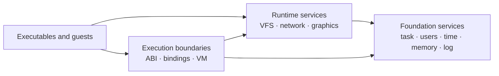

# Modules

Modules are the parts of Xila that give the running system its long-lived behavior: they know about tasks, users, time, paths, network interfaces, graphics state, and the boundaries through which native or WebAssembly code reaches those capabilities.

A useful way to read them is by **role**, not by crate name.

## Mental model

Foundation services provide identity, allocation, time, users, and logging that other runtime behavior depends on. Runtime services turn those foundations into system-level facilities such as the path namespace, networking, and graphics. Execution-boundary pages explain how foreign or guest code reaches the same services.

The arrows are dependency/usage relationships, not a strict boot order. The final binary constructs the concrete managers and integrations that a target needs and keeps them alive for the runtime.

## Foundation services

[Task](/explanation/architecture/modules/task) answers _which logical task is doing this?_ and connects logical task identity to the async executors that actually run futures.

[Users](/explanation/architecture/modules/users) provides user/group identity and membership information used by access-control decisions.

[Time](/explanation/architecture/modules/time) gives the rest of Xila a target-independent time source.

[Memory](/explanation/architecture/modules/memory) defines the allocation contract and connects that contract to Rust's global allocation path.

[Log](/explanation/architecture/modules/log) bridges Xila's logging into the Rust `log` ecosystem and the runtime's chosen output path.

## Runtime services

[Virtual file system](/explanation/architecture/modules/virtual_file_system) owns the shared path namespace. It resolves mounts, applies ownership/permission policy, and routes operations to file systems, devices, or pipes.

[Network](/explanation/architecture/modules/network) owns network-interface stacks and socket services while exposing interface control through the VFS namespace.

[Graphics](/explanation/architecture/modules/graphics) coordinates LVGL, displays, inputs, windows, and events at the graphical runtime boundary.

## Execution and interop boundaries

[ABI](/explanation/architecture/modules/abi) explains the C-facing boundary and the runtime context required to make those calls meaningful.

[Bindings](/explanation/architecture/modules/bindings) explains how guest/host calls translate handles and memory into operations on Xila services.

[Virtual machine](/explanation/architecture/modules/virtual_machine) explains Wasmi-based WebAssembly execution, WASI integration, and cooperative guest scheduling.

These pages sit next to the modules because they shape how runtime capabilities are reached, even where their current implementation lives in executable/runtime code rather than in a standalone stateful manager.

## Choose a page by the concept

- **Paths, files, devices, mounts, or permissions:** [Virtual file system](/explanation/architecture/modules/virtual_file_system)
- **Task identity, spawning, joins, environment, or signals:** [Task](/explanation/architecture/modules/task)
- **Interfaces, sockets, routes, DNS, or network control:** [Network](/explanation/architecture/modules/network)
- **Allocation and platform memory policy:** [Memory](/explanation/architecture/modules/memory)
- **Guest execution:** [Virtual machine](/explanation/architecture/modules/virtual_machine) and [Bindings](/explanation/architecture/modules/bindings)
- **C-facing integration:** [ABI](/explanation/architecture/modules/abi)
- **Windows, displays, and input:** [Graphics](/explanation/architecture/modules/graphics)

## Under the hood: ownership is mostly explicit

The final binary constructs the stateful managers and passes references to consumers rather than relying on production singleton lookups. Lock-protected runtime state therefore belongs to those manager instances.

A few integration boundaries remain process-wide: the allocator, logger, C ABI runtime registration, and LVGL callbacks. Those exceptions matter when reasoning about isolation; “explicit manager ownership” does not imply that every external runtime can currently be instantiated independently more than once in the same process.

For the system-level view around these modules, return to the [architecture overview](/explanation/architecture/).
