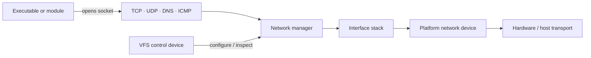
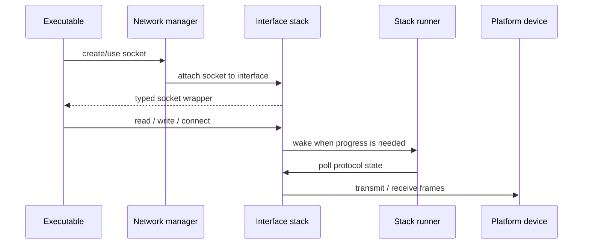
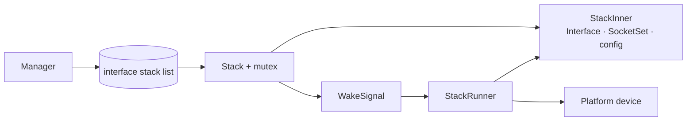

# Network

Xila's Network module sits between applications and platform network hardware. It gives executables portable DNS/TCP/UDP/ICMP services while `smoltcp` handles the protocol stack and a target-specific driver moves packets to and from the actual device.

The same interface also appears in Xila's file namespace as `/devices/network/<name>`, giving the system one control surface for addresses, routes, DNS, DHCP, link state, and backend-specific commands.

## Mental model

A <HostReference crate="network" kind="struct" symbol="Manager" /> owns the collection of interface stacks. Each stack represents one named network interface and combines `smoltcp` protocol state with the platform device that performs packet IO.

The key idea is that applications do not talk to the hardware driver directly. They ask the Network manager for sockets, while interface configuration travels through the VFS control device. Both paths converge on the same interface stack.

## From a mounted interface to a usable socket

When <HostReference crate="network" kind="struct" symbol="Manager" member="method.mount_interface">an interface is mounted</HostReference>, Xila creates a `smoltcp` interface/socket set around the supplied device, starts a runner task for that stack, and exposes a character device at `/devices/network/<name>`.

The runner is what keeps the protocol engine moving. It polls `smoltcp` with the platform device, sleeps when there is nothing useful to do, and can be woken when a socket or control operation changes stack state.

Later, when an executable asks <HostReference crate="network" kind="struct" symbol="Manager" member="method.new_tcp_socket">for a TCP socket</HostReference> (or the corresponding UDP/ICMP/DNS facility), the manager chooses the requested interface or the first available one, adds the protocol socket to that interface's socket set, and returns a typed Xila socket wrapper.

The application-facing call is asynchronous, but actual network progress depends on that runner continuing to be scheduled.

## Control lives in the VFS

Interface configuration is intentionally exposed through the same namespace used for devices elsewhere in Xila. A file opened at `/devices/network/wlan0`, for example, represents the control endpoint for that interface rather than a stream of network payload bytes.

Control commands handled by Xila update stack state such as addresses, routes, DNS, DHCP, or link settings. Commands the Network layer does not own can be forwarded to the controller device supplied by the platform driver. This lets a target expose hardware-specific controls without teaching the portable network manager every device-specific concept.

That command-oriented design is flexible and fits Xila's device model, but it is less discoverable than a single strongly typed high-level configuration object. Persistent policy (for example, remembered Wi-Fi/network profiles) also belongs above this module rather than inside the network stack itself.

## Relationship with other modules

The Network manager depends on several foundational services rather than duplicating their responsibilities:

- [Task](/explanation/architecture/modules/task) provides the runner task and cooperative execution context.
- [Virtual file system](/explanation/architecture/modules/virtual_file_system) provides the `/devices/network/*` control namespace.
- [Time](/explanation/architecture/modules/time) provides the clock converted into `smoltcp` time.
- a random character device supplies seeds used by network state.
- the platform driver supplies the concrete `smoltcp::phy::Device` and a controller device.

High-level protocols such as HTTP or TLS are intentionally outside this layer. Network is concerned with interfaces, addresses, routing/control, name resolution, and transport/socket primitives.

## Under the hood

The current <HostReference crate="network" kind="struct" symbol="Manager" /> stores its stack list in an async `RwLock<Vec<Stack>>` alongside explicit references to Task, VFS, Time, and the random device.

Each `Stack` wraps mutable `StackInner` state behind an async mutex and shares a `WakeSignal` with its runner. `StackInner` contains the interface name and state, `smoltcp::iface::Interface`, `SocketSet`, controller device, DNS/DHCP information, MTU metadata, and local ephemeral-port allocation state.

Socket calls access the stack-local socket set; mutations wake the runner so it can poll promptly. The control path may use non-blocking attempts to acquire stack state, which means contention can surface as `file_system::Error::RessourceBusy` rather than waiting indefinitely.

These locks, container types, wake primitives, and the exact runner loop are implementation choices. Integrations should depend on interface/socket/control semantics rather than on `StackInner` or lock granularity.

## Availability and failure boundaries

An interface name must be unique within a manager, and socket creation needs a suitable available interface. Mounting an interface can also fail if its control device cannot be installed in the VFS or if the runner task cannot be spawned.

Protocol-specific failures are translated from `smoltcp` into the Network module's error domain. Architecturally, the important distinction is between **interface availability**, **control/device integration**, and **socket/protocol state**: failures in any of those layers can prevent a network operation even though the others are healthy.

Scheduling is another boundary. Because the runner executes cooperatively, a starved runner delays protocol progress and therefore increases socket latency. The module does not provide preemptive guarantees beyond what the configured task executors can deliver.

## Extension points and trade-offs

A new platform can integrate networking by providing a `smoltcp::phy::Device` plus its controller device; the Network manager above that pair remains the same. New typed socket wrappers can be layered over the stack/socket-set abstraction, and the device command family can grow as portable control needs evolve.

Capability still varies by backend. A portable command can only be as meaningful as the controller underneath it, and platform-specific commands remain intentionally possible. That is the trade-off that lets one control plane cover both portable state and hardware-specific behavior.

## Explore further

- <HostReference crate="network" /> — complete host-side Network Rustdoc.
- <HostReference crate="network" kind="struct" symbol="Manager" /> — interface and socket manager API.
- <CodeReference path="modules/network" /> — current module implementation.
- [Virtual file system](/explanation/architecture/modules/virtual_file_system) — the namespace hosting interface control devices.
- [Task](/explanation/architecture/modules/task) — the cooperative runner execution model.
- [Std driver](/explanation/architecture/drivers/std) and [WASM driver](/explanation/architecture/drivers/wasm) — examples of target adaptation around the portable services.
