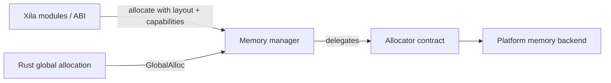
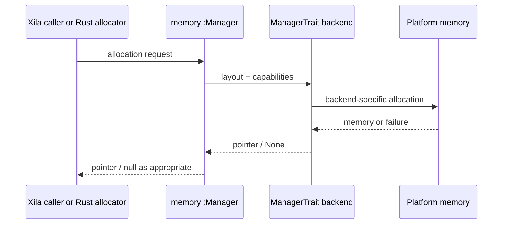

# Memory

Memory allocation has different constraints on a microcontroller, a native host, and other Xila targets. The Memory module keeps the rest of the system from depending directly on one allocator implementation.

Its core idea is simple: Xila defines **what an allocation request means**, then lets the active platform allocator decide how to satisfy it. The same abstraction is also adapted to Rust's global allocation interface, so ordinary Rust allocations and explicit Xila allocation requests ultimately share the runtime's memory backend.

## Mental model

The <HostReference crate="memory" kind="trait" symbol="ManagerTrait" /> is the contract implemented by concrete allocators. The <HostReference crate="memory" kind="struct" symbol="Manager" /> is the thin runtime wrapper that exposes that contract to Xila callers and implements Rust's `GlobalAlloc`.

This split is what lets a target choose its own heap regions and allocation strategy without changing every consumer of memory.

## Two paths, one allocator contract

An explicit Xila allocation can ask <HostReference crate="memory" kind="struct" symbol="Manager" member="method.allocate">the manager to allocate memory</HostReference> with both a `Layout` and capability flags. Those flags currently express requirements such as executable memory or DMA-compatible memory.

Ordinary Rust heap allocation enters through `GlobalAlloc`. The manager translates that standard Rust request into the same underlying `ManagerTrait` contract, using no special capability requirement by default.

Both paths therefore converge before they reach the platform backend:

The different return forms are boundary concerns rather than different allocation systems: the trait uses `Option<NonNull<u8>>`, while the wrapper exposes null pointers where the C/Rust allocator-facing interface expects them.

## Capabilities describe requirements, not algorithms

`CapabilityFlags` lets a caller say something important about the requested memory without selecting a concrete heap. `Executable` and `DirectMemoryAccess` are examples of such requirements.

How strongly a flag can be honoured depends on the backend. On a target with several memory regions, the allocator may choose a suitable region. On another target, the same distinction may have little or no concrete effect. The contract therefore makes the requirement visible while leaving allocation policy target-specific.

The same principle applies to page size and cache management. `ManagerTrait` provides page-size, instruction-cache, and data-cache hooks because some architectures need them, but their concrete semantics and cost belong to the allocator/platform implementation.

## Reallocation and failure semantics

The trait's default reallocation behavior allocates a new region, copies the overlapping amount of data, and then deallocates the old region. That means a failed new allocation leaves the original allocation owned by the caller rather than transferring ownership halfway through the operation.

The runtime wrapper turns failed allocation/reallocation into a null pointer at the pointer-facing boundary. Deallocating a null pointer through the wrapper is intentionally a no-op, matching the expectations of the C-facing allocation surface.

These details matter because raw-memory operations are unsafe: callers and backends must agree on ownership, layout, and lifetime. The module provides one contract for those invariants; it cannot make an invalid raw-pointer use safe after the fact.

## Under the hood

The active runtime exports a `__XILA_MEMORY_MANAGER` symbol containing a `memory::Manager<'static>`. <HostReference crate="memory" kind="fn" symbol="global_manager" /> returns a shared reference to that global wrapper.

Unlike most stateful Xila services, this allocator boundary is intentionally process-global. Rust's global allocator integration itself requires a globally reachable allocation path, so the Memory module is one of the exceptions to the otherwise explicit-manager assembly model described in the [architecture overview](/explanation/architecture/#runtime-assembly).

The wrapper contains a trait object (`&dyn ManagerTrait`) rather than the concrete allocator type. Its `GlobalAlloc` implementation delegates `alloc`, `dealloc`, and `realloc` back through the same methods exposed to explicit Xila callers.

`ManagerTrait: Send + Sync` requires allocator implementations to be safe to call across the runtime's concurrency model, but the trait does not prescribe how a backend synchronizes its internal state. ABI allocation wrappers currently add their own global mutex around the metadata they maintain at that boundary.

This is an implementation-level view. Consumers should not depend on the global symbol name, trait-object representation, backend data structures, or a particular region-selection algorithm.

## Trade-offs and boundaries

The abstraction makes callers portable, but it cannot make every target's memory behave identically. Fragmentation, allocation latency, executable-memory support, DMA constraints, cache coherency, and page-size behavior are ultimately backend properties.

That puts an important responsibility on backend implementations: they must preserve the `ManagerTrait` safety and accounting contract even when their allocation strategies differ substantially.

The module also does not own platform heap discovery or linker-region setup. Those are established by the target/platform integration and then presented through the allocator implementation.

## Contract and implementation boundary

Code outside Memory should rely on allocation/deallocation semantics, `Layout`, capability requirements, statistics, and cache/page hooks. It should not rely on one allocator algorithm, one heap layout, or one synchronization strategy being universal across Xila targets.

## Explore further

- <HostReference crate="memory" /> — complete host-side Memory Rustdoc.
- <HostReference crate="memory" kind="trait" symbol="ManagerTrait" /> — allocator backend contract.
- <HostReference crate="memory" kind="struct" symbol="Manager" /> — runtime and `GlobalAlloc` wrapper.
- <CodeReference path="subsystems/memory" /> — current module implementation.
- [Drivers](/explanation/architecture/drivers) — where target-specific mechanisms meet portable contracts.
- [Synchronization](/explanation/architecture/libraries/synchronization) — synchronization primitives used across Core.
