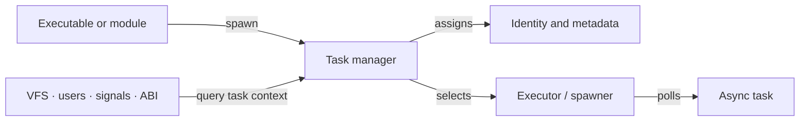
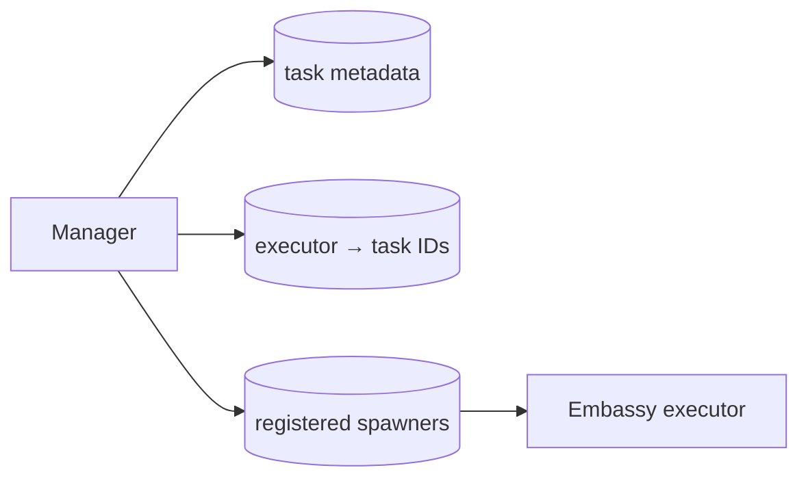

# Task

Xila needs more than an async executor. Other services must be able to answer questions such as _which task is making this request?_, _which user does it run as?_, _what environment does it inherit?_, and _where should a signal be delivered?_

The Task module gives async work that **logical identity and metadata**. Registered Embassy spawners still run the futures; Xila's task manager adds the system-level context around them.

## Mental model

Think of the <HostReference crate="task" kind="struct" symbol="Manager" /> as the directory that connects a Xila task to two different worlds:

- outward, a stable <HostReference crate="task" kind="struct" symbol="TaskIdentifier" /> and metadata that other Xila services can reason about;
- downward, the executor/spawner that actually polls the future.

The distinction matters because executor-internal task identity is an implementation detail. Xila can expose one logical task model to the VFS, user system, ABI, and application runtimes without making those components depend directly on Embassy internals.

## What happens when a task is spawned?

When runtime code asks <HostReference crate="task" kind="struct" symbol="Manager" member="method.spawn">the manager to spawn work</HostReference>, the manager first creates a logical task record. That record inherits user, group, and environment information from its parent when the parent is known.

The manager then chooses the requested spawner or, when none is specified, the currently least-loaded registered spawner. Embassy receives the future and performs the actual cooperative execution. Once the future begins running, Xila associates Embassy's internal task identity with the logical `TaskIdentifier`, allowing <HostReference crate="task" kind="struct" symbol="Manager" member="method.get_current_task_identifier">other code to recover the current Xila task</HostReference> later.

When the future finishes, its join handle is signalled and the manager removes the task metadata. If that task had children, they are reparented to the root task rather than being left with a dead parent.

This is a lifecycle description, not a requirement for callers to manually register and unregister tasks: `spawn` owns that bookkeeping for normal spawned work.

## What the task identity carries

A task record is deliberately broader than an executor handle. It currently tracks:

- a short human-readable name;
- parent/child relationship;
- user and group identifiers;
- inherited environment variables;
- pending signal state;
- the selected spawner and the executor-internal identifier used for reverse lookup.

That is why seemingly unrelated modules depend on Task. The VFS can apply permissions in the context of the calling task, executables can inherit environment state, signal delivery has a stable destination, and runtime boundaries can carry one task identifier instead of learning executor-specific details.

## Scheduling is still cooperative

The Task module does **not** implement a preemptive CPU scheduler or process address-space isolation. It delegates execution to Embassy executors. A future that never awaits or yields can therefore starve other work scheduled on the same executor.

Spawner selection is also intentionally simple: the current heuristic balances by registered task count, not CPU consumption, latency, or IO cost. Registering several spawners makes multi-executor deployments possible, but it does not turn the manager into a workload-aware scheduler.

## Under the hood

Each <HostReference crate="task" kind="struct" symbol="Manager" /> owns an async `RwLock` around three `BTreeMap`s:

- `tasks: BTreeMap<TaskIdentifier, Metadata>` stores the logical task records;
- `identifiers: BTreeMap<usize, TaskIdentifier>` maps executor-internal identity back to Xila identity;
- `spawners: BTreeMap<usize, embassy_executor::Spawner>` stores the execution endpoints available to this manager.

Read-heavy metadata queries take the read side of that lock; registration, removal, environment mutation, and signal changes take the write side.

`Manager::new()` creates those registries without installing a production singleton. The current executor task becomes that manager's logical root when the manager first needs to resolve it. Test/test-harness configurations retain helper accessors, but production integrations are expected to pass the manager explicitly.

Task names are currently stored in an inline `SmolStr` and truncated to 23 bytes during registration. Environment variables are cloned from the parent task into the child record. Signals are represented by a `SignalAccumulator` bitset.

This diagram describes the **current implementation**, not the public task contract. The map layout, lock granularity, name storage, and spawner-selection heuristic may evolve without changing what a task identifier means to callers.

## Failure and resource boundaries

The manager has finite identifier space, so registration can fail with `TooManyTasks`. Asking for an unknown explicit spawner fails with `InvalidSpawnerIdentifier`, while operations on stale/unknown logical identifiers can return `InvalidTaskIdentifier`.

Those exact variants are reference-level details; architecturally, the important point is that logical registration and executor dispatch can fail independently. A task is only useful after both the logical record and its execution mapping are established.

The C/ABI thread surface is also not yet complete: several `xila_thread_*` entry points remain unfinished. That limitation belongs to the ABI boundary rather than changing the internal Task model described here.

## Contract and implementation boundary

Code using Task should depend on manager-scoped identity, metadata, spawn/join behavior, environment inheritance, and signal semantics. It should not rely on the `BTreeMap` layout, internal Embassy identifier, current balancing heuristic, or fixed-width task-name policy.

## Explore further

- <HostReference crate="task" /> — complete host-side Task Rustdoc.
- <HostReference crate="task" kind="struct" symbol="Manager" /> — manager API and associated methods.
- <HostReference crate="task" kind="struct" symbol="TaskIdentifier" /> — logical task identifier.
- <CodeReference path="subsystems/task" /> — current implementation.
- [Users](/explanation/architecture/subsystems/users) — identity information stored on tasks.
- [Virtual file system](/explanation/architecture/subsystems/virtual_file_system) — a major consumer of task context.
- [Time](/explanation/architecture/subsystems/time) — another foundational service used alongside Task.
