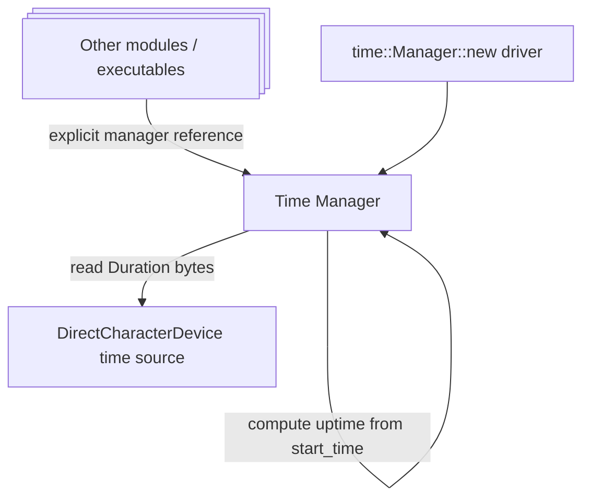

# Time

The Time module provides an explicitly constructed time source for Xila services.

## Role in system

- Supplies current time to modules that stamp metadata (for example VFS attributes).
- Supplies uptime-like elapsed time since manager initialization.
- Acts as the canonical time source adapter for platform drivers.

## Responsibilities and boundaries

**In scope**

- Manager construction with a borrowed direct character device source.
- `get_current_time()` and `get_current_time_since_startup()` query APIs.
- Conversion between device byte payload and `core::time::Duration`.

**Out of scope**

- Time synchronization protocols.
- Timezone/calendar policy.
- Multi-source clock arbitration.

## Internal architecture

- `Manager::new(driver)` returns an owned manager; the compatibility helper `time::initialize(driver)` also returns a manager, rather than installing a singleton.
- `Manager` stores:
  - a borrowed `DirectCharacterDevice + Send + Sync` with a lifetime tied to the manager,
  - `start_time: Duration` captured at initialization.
- Current-time reads deserialize `Duration` directly from device bytes.

**Contract vs implementation**

- **Contract**: callers get `Duration` values and error on device/read failures.
- **Implementation**: exact wire representation assumes device emits in-memory `Duration` layout expected by this build.



## Lifecycle and execution model

1. Platform provides time device implementation.
2. `time::Manager::new(driver)` captures the startup timestamp.
3. Pass a reference to runtime consumers for current time or elapsed since startup.

## Data/control flow

- Read path: module caller -> time manager -> direct character device read -> `Duration`.
- Uptime path: current read - cached startup time.

## Concurrency and synchronization model

- Manager state is immutable after initialization (device handle + start time).
- Read calls are lock-free in manager layer and depend on driver thread-safety guarantees.

## Dependency model

- Upstream dependency: platform `DirectCharacterDevice` implementation.
- Downstream consumers: VFS, graphics tick callback, network time conversion.

## Failure semantics and recovery behavior

- Initialization fails if initial time read fails.
- Runtime queries propagate device read failures as `time::Error`.
- No internal retry/backoff policy; callers decide recovery strategy.

## Extension points

- Replace time source driver per target.
- Add higher-level synchronization layers above this module.
- Extend manager with optional monotonic/wall-clock source separation.

## Known limitations and trade-offs

- Read-only API surface (no set-time operation in current module).
- Accuracy/monotonic behavior depends entirely on device implementation.
- Wire contract currently assumes compatible `Duration` representation at device boundary.

## Implementation details and clock semantics

The current manager is a small adapter around a borrowed `DirectCharacterDevice + Send + Sync`. Construction reads the device once and stores that `Duration` as `start_time`. Each `get_current_time()` call reads a fresh `Duration` directly from the device at offset zero; it does not cache or interpolate between reads.

`get_current_time_since_startup()` returns `current_time.abs_diff(start_time)`. This is **not an independently monotonic clock**: if the underlying clock moves backwards, the reported elapsed value can still increase because the implementation uses an absolute difference. Callers requiring monotonic deadlines must use a separate monotonic time source.

The device read uses the in-memory representation of `core::time::Duration` as a byte buffer. This makes the driver/manager boundary dependent on the expected representation and exact read behavior; it is not a stable cross-platform serialized timestamp format.

`Manager::new(&device)` returns an owned manager borrowing the device, while `initialize(&'static device)` is a compatibility constructor returning `Manager<'static>`, **not** a global singleton. Construction and reads propagate device errors.

### Example

```rust
let clock = time::Manager::new(&device)?;
let now = clock.get_current_time()?;
let elapsed = clock.get_current_time_since_startup()?;
```

The example assumes `device` implements the required direct character-device contract. Timezone names, daylight-saving transitions, persistent wall-clock configuration and NTP synchronization are not handled by this manager.

### Implementation references

- <CodeReference path="modules/time/src/manager.rs" />
- <HostReference crate="time" kind="struct" symbol="Manager" />

## References / See also

- <HostReference crate="time" />
- [Drivers](/explanation/architecture/drivers)
- [Synchronization](/explanation/architecture/libraries/synchronization)