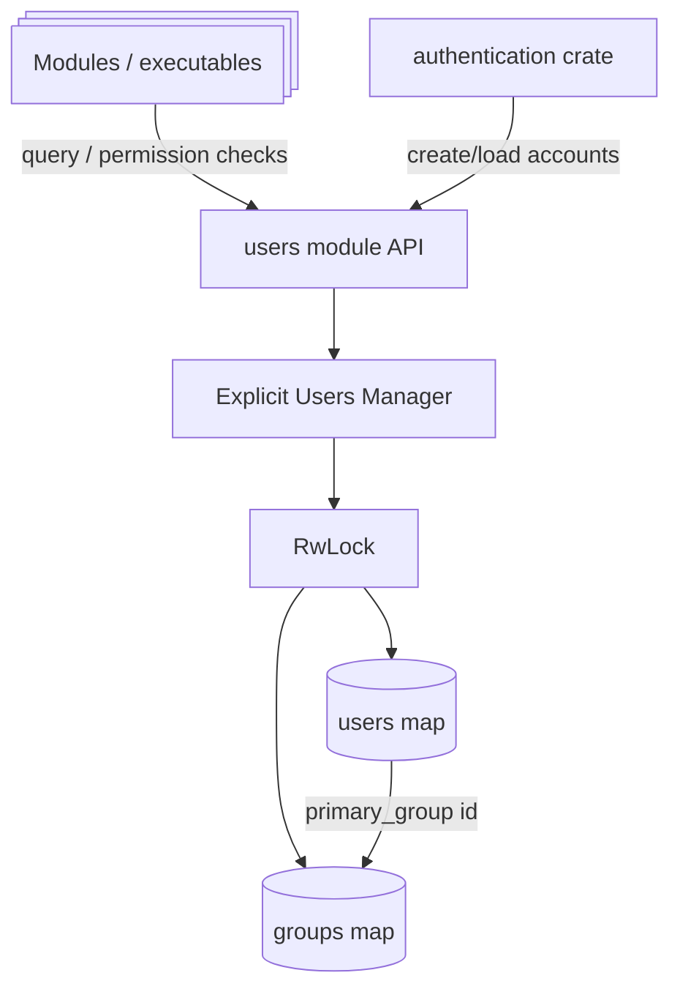

# Users

The Users module is Xila's in-memory identity and group membership registry.

## Role in system

- Supplies user/group identity data for permission checks and ownership metadata.
- Allocates and resolves typed identifiers used by task and VFS layers.
- Guarantees root account/group bootstrap at manager initialization.

## Responsibilities and boundaries

**In scope**

- User/group insertion and lookup.
- Membership tracking (`add_to_group`, `is_in_group`, `get_user_groups`).
- Identifier and name resolution APIs.

**Out of scope**

- Credential verification policy (current `check_credentials` is placeholder-like).
- Authentication/session/token management.
- Persistent storage (state is runtime memory only).

## Internal architecture

- Explicit `users::Manager::new()` with references passed to VFS, authentication, and executables.
- Internal `RwLock` protects:
  - `users: BTreeMap<UserIdentifier, InternalUser>`,
  - `groups: BTreeMap<GroupIdentifier, InternalGroup>`.
- `InternalUser` stores name + primary group.
- `InternalGroup` stores group name + membership set (`BTreeSet<UserIdentifier>`).

**Contract vs implementation**

- **Contract**: typed identifier APIs and membership/name lookup behavior.
- **Implementation**: exact map/set layout, root bootstrap details, allocation scan strategy.

## Lifecycle and execution model

1. Construct a manager; root user/group are inserted immediately.
2. Allocate identifiers for additional users/groups.
3. Register users/groups and membership before launching constrained workloads.
4. Query identity/membership during runtime from task/VFS policy paths.

## Data/control flow

- Task metadata uses user/group identifiers from this module.
- VFS permission checks use the supplied users manager's `is_in_group(...)` method.
- Name-based resolution provides bridge between human-readable config and typed runtime ids.

## Concurrency and synchronization model

- Single `RwLock` guards all user/group data.
- Read operations scale concurrently.
- Mutating operations (add user/group/member) take write lock and enforce duplicate checks.

## Dependency model

- Used directly by [Task](/explanation/architecture/subsystems/task) and [Virtual file system](/explanation/architecture/subsystems/virtual_file_system).
- Higher-level authentication crate composes over this module rather than embedding inside it.

## Failure semantics and recovery behavior

- Duplicate identifiers/names return explicit duplicate errors.
- Invalid user/group references return typed invalid-identifier errors.
- Identifier allocation fails with `TooManyUsers` / `TooManyGroups` on range exhaustion.

## Extension points

- Add richer metadata per user/group while preserving typed id model.
- Add batch APIs for provisioning workflows.
- Add persistent snapshot/load layers in higher-level components.

## Known limitations and trade-offs

- Runtime-only storage; no built-in persistence.
- Current credential-check method is not a complete authentication implementation.
- One manager lock coordinates its identity registry.

Persistent groups are loaded before users. Registering a restored user tolerates primary-group membership already present in the saved group; duplicate user identifiers and names still fail.

## References / See also

- <HostReference crate="users" />
- [Authentication (crate)](/explanation/architecture/libraries/authentication)

## Registry invariants and implementation caveats

The manager stores users and groups in `BTreeMap` collections behind an asynchronous `RwLock<CriticalSectionRawMutex, _>`; each group's membership is a `BTreeSet<UserIdentifier>`. `Manager::new()` creates the root user and root group. Identifier allocation helpers scan from their minimum value until an unused identifier is found and report `TooManyUsers` or `TooManyGroups` at the limit.

`add_user(id, name, primary_group)` rejects duplicate user IDs and names. The implementation inserts the user into the map before resolving the primary group. **A missing primary group therefore returns `InvalidGroupIdentifier` after the user record was inserted**, so callers should validate that the group exists before calling `add_user`. The group membership insertion is idempotent to support restoration of previously loaded membership.

`add_group(id, name, users)` rejects duplicate group IDs and names, and initializes membership from the supplied slice. `add_to_group()` checks group existence, then inserts a user identifier; it does not itself verify that the user exists. Membership queries read the group sets, not a separately maintained reverse index.

`check_credentials()` currently returns `true` unconditionally. **Do not treat it as an authentication or authorization boundary.** Credential verification and session policy must be provided by the appropriate authentication component. The registry itself is in-memory; persistence is handled by surrounding system integration rather than automatically by `Manager`.

### Implementation references

- <CodeReference path="modules/users/src/manager.rs" />
- <HostReference crate="users" kind="struct" symbol="Manager" />
- [Authentication library](/explanation/architecture/libraries/authentication)
