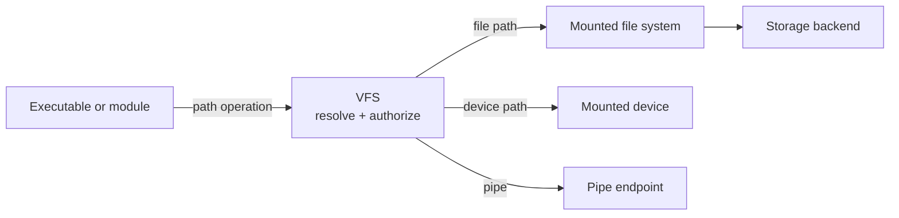
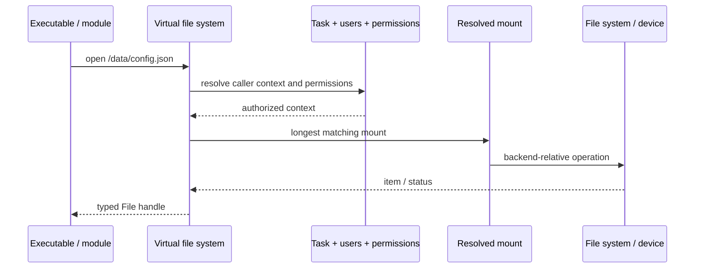
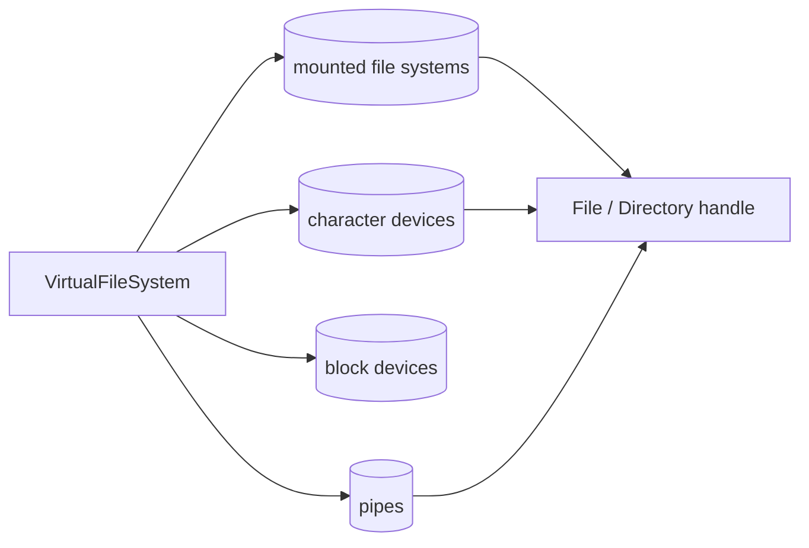

# Virtual file system

Xila has several things that can look like files: persistent storage, character devices, block devices, pipes, and control endpoints such as network interfaces. The Virtual File System (VFS) gives all of them one path namespace and one place to apply access policy.

The VFS does **not** define how LittleFS stores blocks or how a device implements IO. Its job is to decide _what owns this path?_, _is this task allowed to access it?_, and _where should the operation go next?_

## Mental model

Think of the <HostReference crate="virtual_file_system" kind="struct" symbol="VirtualFileSystem" /> as a router for paths:

The VFS owns the **namespace and policy**, while the mounted backend owns the concrete storage/device behavior. That separation is what allows a caller to use the same file-facing abstractions regardless of whether `/data/example` lives in LittleFS or `/devices/network/wlan0` represents a control device.

## Following one path through the system

Suppose an executable opens `/data/config.json` through <HostReference crate="virtual_file_system" kind="struct" symbol="File" member="method.open">`File::open`</HostReference>. It does not talk directly to the root file system.

The VFS first associates the request with the supplied Xila task, derives user/group and time context from its Task, Users, and Time dependencies, and resolves which mount owns the path. It then checks the relevant permissions before translating the absolute path into the backend-relative path understood by that mount.

Only after those namespace and policy decisions does the request reach the mounted backend through the <HostReference crate="file_system" kind="trait" symbol="FileSystemOperations" /> contract.

The same routing idea applies to directories and devices. The difference is the kind of mounted endpoint and the operations supported after resolution, not a separate namespace implementation.

## Why Task, Users, and Time are dependencies

The namespace alone is not enough to behave like a system file layer.

[Task](/explanation/architecture/subsystems/task) tells the VFS which logical task initiated an operation and therefore which user/group context applies. [Users](/explanation/architecture/subsystems/users) answers membership questions used during permission checks. [Time](/explanation/architecture/subsystems/time) provides the timestamps written during create/access/modify operations.

This is why a `VirtualFileSystem` is explicitly constructed with references to those managers. The VFS centralizes filesystem policy without reimplementing identity or time itself.

## Backends share contracts, not implementations

Regular file-system backends implement <HostReference crate="file_system" kind="trait" symbol="FileSystemOperations" />. Character and block devices use the corresponding device contracts. Pipes are provided as in-memory endpoints by the VFS itself.

Because the VFS dispatches through these contracts, mounting a new backend does not require callers to learn a new path API. The backend can still have completely different on-disk or device semantics underneath that contract.

This division also defines a boundary: authentication/session policy lives above the VFS, while concrete block layout and wear-level/storage algorithms live below it.

## Mounts and handles have lifetimes

Resolving a path is not the end of the VFS's job. Open files/directories and mounted devices keep references into backend state, so the VFS tracks live use to prevent a normal unmount from invalidating active handles.

An unmount can therefore report a busy resource while references are alive. A forced unmount deliberately overrides that protection. This is an architectural consequence of exposing long-lived typed handles rather than copying every operation into a stateless path request.

For async operations that encounter a temporarily busy backend, the VFS `poll(...)` helper cooperatively yields through Task and retries. A handle opened with the non-blocking state instead surfaces the busy condition rather than waiting for it to clear.

## Under the hood

The current VFS is an explicitly owned <HostReference crate="virtual_file_system" kind="struct" symbol="VirtualFileSystem" />. `initialize(...)` constructs it from Task, Users, Time, and the root `FileSystemOperations` implementation.

Its mutable routing state is divided across `RwLock<CriticalSectionRawMutex, ...>` collections:

- `file_systems: Vec<InternalFileSystem>` stores mount points, backend pointers, and reference counts;
- a character-device `BTreeMap` maps inodes to mounted character endpoints;
- a block-device `BTreeMap` does the same for block endpoints;
- a pipe `BTreeMap` tracks in-memory pipe endpoints.

Mount resolution selects the file system whose mount point owns the requested path and forwards a relative path to that backend. Typed `File` and `Directory` wrappers retain the VFS/backend context needed for later operations rather than resolving the absolute path again for every byte transferred.

Those collection choices, lock boundaries, inode maps, and reference-count strategy are current implementation details. The stable architectural idea is the shared namespace, policy gate, mount dispatch, and typed handle semantics.

## Default namespace shape

`create_default_hierarchy(...)` gives a newly assembled runtime a conventional set of locations. The exact tree is useful because these paths communicate intent across modules, but it should be read as a namespace convention rather than a statement about one physical disk:

- `/binaries` — executable files;
- `/configuration` — user-space configuration, including `/configuration/shared`;
- `/data` — application data, including `/data/shared`;
- `/devices` — mounted device endpoints, including `/devices/network`;
- `/logs` — system/application logs;
- `/system` — system-owned data such as `/system/users` and `/system/groups`;
- `/temporary` — temporary data expected to be cleared across reboot/runtime recreation.

The root backend provides the base tree, while additional file systems and devices can be mounted into that namespace later.

## Failure and policy boundaries

A path can fail before the backend is called: the path may be invalid, its mount may not resolve, required metadata may be absent, or permissions may reject the operation. Backend errors then enter the VFS error domain after dispatch.

This distinction is useful when debugging: `PermissionDenied` is a policy decision made before backend execution, while a backend `NotFound`/IO failure describes what happened after routing to the selected implementation.

Device cleanup helpers intentionally tolerate stale device identifiers in expected cleanup cases, making repeated startup cleanup more idempotent. By contrast, live-reference protection on unmount is deliberately strict unless force is requested.

## Limitations and trade-offs

Centralizing namespace and permission policy gives all callers consistent semantics, but it also means shared VFS metadata locks can become contention points under heavy parallel access.

Symbolic-link and advisory file-locking behavior is not implemented in the current surface, and the C/ABI filesystem layer still has incomplete entry points such as some symlink, timestamp, and truncate operations. That ABI incompleteness should not be confused with the full set of internal Rust VFS capabilities.

New file systems can be integrated by implementing the file-system contracts and mounting them; new devices can implement the direct character/block contracts and be placed at namespace paths. Callers should depend on those semantics rather than on internal collection types or initialization helpers.

## Explore further

- <HostReference crate="virtual_file_system" /> — complete host-side VFS Rustdoc.
- <HostReference crate="virtual_file_system" kind="struct" symbol="VirtualFileSystem" /> — namespace and mount manager API.
- <HostReference crate="virtual_file_system" kind="struct" symbol="File" /> — async file handle API.
- <HostReference crate="file_system" kind="trait" symbol="FileSystemOperations" /> — backend contract consumed by the VFS.
- <CodeReference path="subsystems/virtual_file_system" /> — current VFS implementation.
- [File-system crate](/explanation/architecture/libraries/file_system) — shared storage/device contracts beneath the VFS.
- [Network](/explanation/architecture/subsystems/network) — an example of a module exposing control devices through the namespace.
- [Task](/explanation/architecture/subsystems/task) and [Users](/explanation/architecture/subsystems/users) — identity context used by VFS policy.
