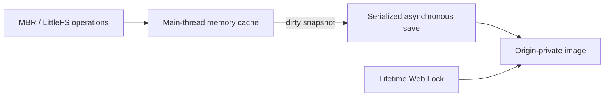

# Browser storage

The browser example keeps Xila's filesystem in an origin-private OPFS image. Its design bridges synchronous block-device operations and asynchronous storage APIs while preserving an existing disk on startup errors.

## The disk and its origin

The example's MBR/LittleFS disk is stored as `xila_drive.img`. Files, configuration, and credentials can survive reloads on the same origin. Another origin has separate storage, even when it serves the same application.

On a fresh image, startup creates the default administrator account with an empty password. On an existing image, it restores users and groups, including when the administrator was removed. Invalid partition tables or filesystem mount errors stop boot without reformatting the saved image. Changing the requested disk size does not silently resize it.

## Why there is a memory cache

Synchronous OPFS handles are available in workers, while this example's UI and filesystem operate on the browser main thread. The drive therefore serves synchronous block operations from a bounded, disk-sized memory cache and commits snapshots asynchronously through `DriveDevice::sync().await`.

Synchronous filesystem flushes update this cache, not OPFS. A completed asynchronous sync establishes that a snapshot was committed and reports storage errors to the caller.

## Autosave and ownership

A lifetime Web Lock gives one Xila tab access to the disk. Another tab cannot open the image until the first releases it; this prevents independent caches from writing competing images.

The example saves at boot, every second when dirty, and on normal shutdown. Clean disks are not rewritten. Saves are serialized and atomic, with one additional disk-sized snapshot rather than an unbounded queue. Autosave failures are logged and retried; unsaved changes remain available in the cache.

The example uses a 16 MiB cache and temporarily needs another 16 MiB snapshot while saving, plus browser buffering. Bundled Calculator bytes, the VFS copy, the interpreter, and guest memory add further costs. The convenience of an embedded application and main-thread cache therefore has a meaningful peak-memory cost.

## Durability boundaries

Abrupt reloads, tab closure, and crashes can lose changes since the last successful save. Background-tab timer throttling can extend that interval. OPFS is browser-managed: quota limits, private browsing, eviction, or clearing site data can remove it. It is not a replacement for backups.

Resetting is an explicit user action; a mount failure does not grant startup permission to erase the image. The [reset procedure](/how-to/reset-browser-storage) describes the consequences and how to remove it deliberately.

## Related documentation

- [Browser capabilities](/reference/wasm-runtime#browser-capabilities).
- [WASM drive integration](./architecture/drivers/wasm).
- [Browser validation](/how-to/validate-core#browser-behavior).
- <CodeReference path="drivers/wasm/src/devices/drive.rs" /> and <CodeReference path="examples/wasm/src/storage.rs" />.
