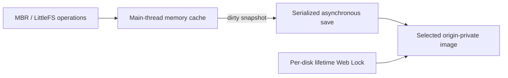

# Browser storage

The browser example keeps Xila filesystems in origin-private OPFS images. Its design bridges synchronous block-device operations and asynchronous browser storage while preserving existing disks on startup errors.

## Disks and their origin

Each browser disk is a 16 MiB MBR/LittleFS image stored on the current origin. The legacy image is named `xila_drive.img`. New images created from the Help panel use `xila_YYYY-MM-DD.img`, with a numeric suffix when more than one image is created on the same date. The selected disk is remembered for the origin.

Files, configuration, and credentials survive reloads when the browser keeps the corresponding OPFS image. Another origin has separate storage, even when it serves the same application.

A new image is initialized from a prebuilt, locale-matched LittleFS seed containing the bundled applications and shortcut metadata. Updating Xila or its reference seed does **not** silently replace applications already installed in an existing image; create another disk if you need the newer bundle while keeping the old disk as a backup.

On a fresh image, startup creates the default administrator account with an empty password. On an existing image, it restores users and groups, including when the administrator was removed. Invalid partition tables or filesystem mount errors stop boot without reformatting the saved image. Changing the requested disk size does not silently resize an existing image.

## Why there is a memory cache

Synchronous OPFS handles are available only in workers, while this example's UI and filesystem operate on the browser main thread. The drive therefore serves synchronous block operations from a bounded, disk-sized memory cache and commits snapshots asynchronously through `DriveDevice::sync().await`.

Synchronous filesystem flushes update this cache, not OPFS. A completed asynchronous sync establishes that a snapshot was committed and reports storage errors to the caller.

## Ownership, switching, and removal

A lifetime Web Lock gives one Xila tab access to a particular disk. Another tab cannot open that same image until the first releases it. Different tabs may use different Xila images on the same origin.

The Help panel lists managed images, creates new ones, selects a different image, and removes unused images. Switching disks first stops new writes, commits pending changes, releases the current disk lock, then reloads Xila with the selected image. If the save or switch fails, the runtime keeps the current image selected rather than silently abandoning it.

The active disk cannot be removed from its own tab. Removal also acquires the target disk's lock, so an image opened by another tab is rejected. Deletion is permanent for that image and requires confirmation in the browser UI.

## Autosave and memory cost

The example saves at boot, every second when dirty, and on normal shutdown. Clean disks are not rewritten. Saves are serialized and atomic, with one additional disk-sized snapshot rather than an unbounded queue. Autosave failures are logged and retried; unsaved changes remain available in the cache.

For the selected 16 MiB image, the example uses a 16 MiB cache and temporarily needs another 16 MiB snapshot while saving, plus browser buffering. Bundled guest bytes, VFS copies, the interpreter, guest memory, and graphical resources add further costs. Additional stored disk images consume persistent OPFS quota but are not all cached in RAM at once.

## Durability boundaries

Abrupt reloads, tab closure, and crashes can lose changes since the last successful save. Background-tab timer throttling can extend that interval. OPFS is browser-managed: quota limits, private browsing, eviction, or clearing site data can remove images. It is not a replacement for backups.

Disk removal is an explicit user action; a mount failure does not grant startup permission to erase an image. The [browser disk procedure](/how-to/reset-browser-storage) explains how to create, switch, and deliberately remove images.

## Related documentation

- [Browser capabilities](/reference/wasm-runtime#browser-capabilities).
- [WASM drive integration](./architecture/drivers/wasm).
- [Browser validation](/how-to/validate-core#browser-behavior).
- <CodeReference repo="platforms" path="drivers/wasm/src/devices/drive.rs" /> and <CodeReference repo="platforms" path="examples/wasm/src/storage.rs" />.
