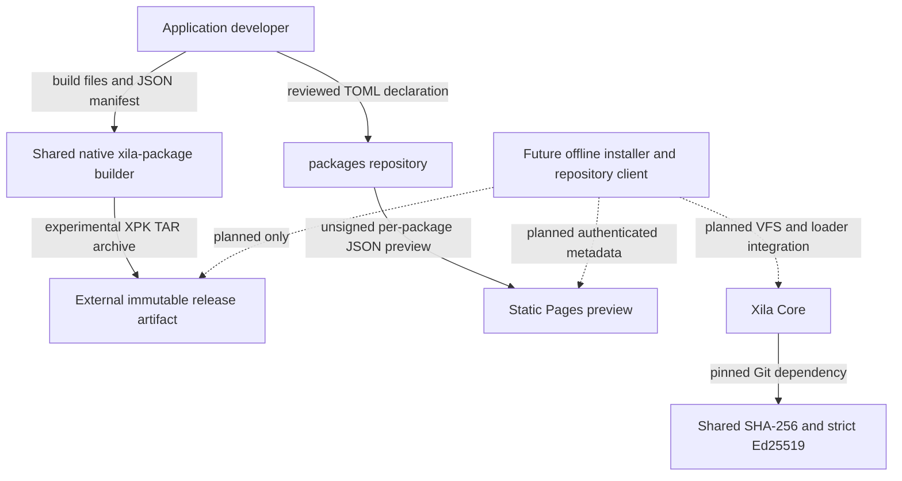

# Package management architecture

Xila's application distribution is split across **three repositories**. As of 26 October 2026, authoring and inspecting development archives and generating a static **unsigned registry preview** work; downloading, authenticating and installing third-party packages on Xila **does not**.

The repositories and APIs are being developed under [Core #308](https://github.com/xila-project/core/issues/308), the [package format decision #402](https://github.com/xila-project/core/issues/402), and the [shared workspace extraction #536](https://github.com/xila-project/core/issues/536). The experimental `.xpk` extension, TAR profile and manifest schema are **not frozen for production**.

## Repository ownership

| Repository                                                                        | Owns today                                                                                                    | Does not own                                                                                  |
| --------------------------------------------------------------------------------- | ------------------------------------------------------------------------------------------------------------- | --------------------------------------------------------------------------------------------- |
| [`Xila-Project/package_manager`](https://github.com/xila-project/package_manager) | Shared verification, provisional manifest, TAR reader/writer, native `xila-package` builder and Cargo/mise CI | Xila VFS, network drivers, package trust policy, implemented installer                        |
| [`Xila-Project/packages`](https://github.com/xila-project/packages)               | Contributor TOML declarations, strict validation and static GitHub Pages **preview** generation               | Rust manifest/reader libraries, packages themselves, authenticated repository indexes         |
| [`Xila-Project/core`](https://github.com/xila-project/core)                       | Runtime VFS/Wasmi/application loader, firmware prototype and **pinned shared verification dependency**        | A working `pkg` command, package installation/activation, on-device package-repository client |

The actual Rust workspace is named **`package_manager`** (underscore). Its Cargo package names use `xila-package-…` prefixes, for example `xila-package-manifest`. The eventual installed Xila package manager must not be confused with that development repository.

**Dependency direction:** shared package libraries must depend on neither Core nor the community registry. Core and the registry may consume the shared tools. Any Core-specific disk, task, permissions, loader or networking implementation belongs in Core, not in the portable format crates.

## What exists versus what is still planned

| Capability                                                                                   | Current status                  |
| -------------------------------------------------------------------------------------------- | ------------------------------- |
| Versioned JSON manifest, validated paths/files/hashes                                        | Provisional Rust implementation |
| Deterministic uncompressed USTAR archive generation                                          | Native host tool implemented    |
| Full-buffer TAR inspection and optional verification with caller-supplied Ed25519 public key | Implemented, **not streamable** |
| SHA-256 streaming and strict Ed25519 primitives                                              | Shared and used by Core         |
| Contributor declaration validation and direct-path static JSON preview                       | Implemented, **unsigned**       |
| Trust-root provisioning, signed repository index, authenticated publisher roles              | **Not implemented**             |
| Streaming archive extraction with MCU-bounded RAM, optional decompression                    | **Not implemented**             |
| Transactional package install/upgrade/remove, installed-package database                     | **Not implemented**             |
| In-Xila `pkg` CLI or GUI, version/dependency resolution, loader enforcement                  | **Not implemented**             |

The `xila-package-manager` Cargo crate currently contains **only a scaffold**, not an install API. Core's signed **firmware** update prototype is separate and must not be mistaken for an **application** package installer.

## Security model and why a checksum is not enough

A package can have a valid SHA-256 hash and still be malicious or substituted when the expected hash came from **unsigned metadata**. A secure future workflow needs three separate checks:

1. **Repository identity:** authenticate a repository or publisher with keys trusted **outside** the downloaded metadata; protect versions against rollback or freeze attacks.
2. **Package integrity and origin:** authenticate a signed, versioned manifest that covers every install-relevant file, size, path, hash, target, ABI and requested capability; verify the complete payload.
3. **Installation and execution authorization:** stage files safely, commit atomically, track ownership/version and enforce the package's permissions on launch. A valid publisher signature alone **must not grant privileged VFS or device access**.

Today's reader can verify the manifest with an externally trusted public key, but there is no built-in key authorization or installation transaction. The static registry's JSON is **not signed**. HTTPS alone does not replace either trust decision.

## Why the current TAR implementation is not yet MCU-ready

The initial design uses `tar-no-std` over a borrowed **complete archive byte slice**, and the Miniserde manifest parser requires `alloc`. The host builder also loads all payloads into memory and rereads the resulting archive. None of these paths provides bounded-memory installation from an unseekable HTTP stream.

Before shipping to ESP32-S3, [format issue #402](https://github.com/xila-project/core/issues/402) must compare restricted TAR, CPIO `newc`, SWUpdate/IPK/APK ideas and small custom framing using actual parser/stack/flash/RAM measurements. Whatever container is selected must authenticate bounded metadata before interpreting untrusted payloads, stream per-file hashes into non-executable staging, reject unexpected archive semantics, and recover from failures before activation.

## Follow-up ownership

- [#402](https://github.com/xila-project/core/issues/402): canonical signed bytes, container choice and streaming archive reader.
- [#491](https://github.com/xila-project/core/issues/491): offline trusted installation, staging, ownership and crash recovery.
- [#492](https://github.com/xila-project/core/issues/492): optional authenticated repository metadata and lightweight dependency planning.
- [#493](https://github.com/xila-project/core/issues/493): in-target package command interface.
- [#494](https://github.com/xila-project/core/issues/494): host authoring/signing/inspection tools.
- [#495](https://github.com/xila-project/core/issues/495): runtime loader verification and time-of-check/time-of-use enforcement.
- [#536](https://github.com/xila-project/core/issues/536): shared-repository integration and format source of truth.

## Continue

- [Prototype package format and API](/reference/package-format).
- [Create a development package](/how-to/package-application).
- [Contribute a registry declaration](/how-to/submit-package).
- [Shared verification](/explanation/architecture/libraries/verification).
- [Firmware update prototype](/explanation/architecture/libraries/firmware_update) — a separate mechanism.
