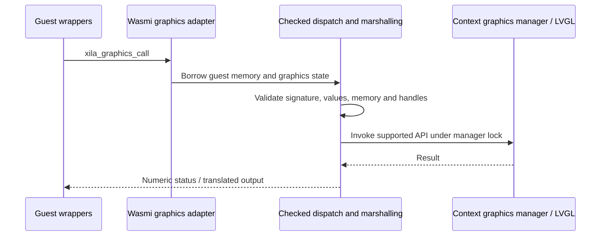

# 🔗 Bindings

Xila's graphics bindings connect guest WebAssembly imports to the context-provided graphics manager. The shared LVGL catalog is generated in `modules/graphics/bindings_generator`; host dispatch and the Wasmi adapter live in `executables/wasm/src/host/graphics`.

## Architecture and ownership

- `graphics_bindgen` discovers and orders the shared catalog. Unsupported calls keep their IDs, and the supported-call table checks complete C signatures.
- Guest wrappers import `xila_graphics_call`; `default_guest` also emits C wrappers and `xila_graphics.h` in the build output directory. Generation does not rewrite guest source files.
- `dispatch`, `objects`, and `marshal` use explicit graphics state and checked borrowed memory, without Wasmi types or global graphics-manager lookup.
- `graphics/wasmi.rs` handles store/memory access, import registration, and context capability checks.
- VM-local object handles represent host objects. Deletion invalidates handles; issued handles are not reused within an execution. Teardown removes owned windows and children, including after traps.
- Retained button-map strings and pointer tables are copied into VM-owned storage; guest memory growth or mutation cannot invalidate them. Label strings are copied synchronously by LVGL.

## Compatibility and supported calls

The catalog requires guest and host bindings built from the same LVGL revision and configuration; call IDs are not a stable cross-version graphics ABI. Core now uses LVGL 9.6, including its updated event codes.

The supported milestone covers window creation/icon/event retrieval, object creation/deletion, flex flow/grow, width/height, flags, labels, button matrices, and percentage conversion. Calculator exercises this subset. Weather still needs APIs beyond it.

Calls involving arbitrary native structure layouts, guest callbacks, retained guest pointers, fonts/images/charts, or other unsupported LVGL functions return an unsupported status. Guest memory is never interpreted as a typed host reference.

## Resource limits and status

- 256 issued object handles per execution, including deleted handles.
- 64 button-map entries including the sentinel; 1024 bytes per NUL-terminated string.
- 8192 retained map-string bytes per widget, including the native sentinel.
- Null and empty-string map sentinels become LVGL's empty-string terminator; row separators are retained.

Status 0 is success. Error statuses are invalid count (1), invalid memory (2), unavailable capability (3), unsupported call (4), invalid handle (5), resource limit (6), invalid value (7), and native failure (8).

## Extension points and validation

Extend the shared catalog and checked dispatch together, and keep the Wasmi adapter thin. Validate memory and handle behavior before adding a supported call. Native adapter and lifetime tests exercise cleanup; the portable translation tests separately cover guest-memory boundaries and word widths.

## References / See also

- <CodeReference path="modules/graphics/bindings_generator" />
- <CodeReference path="executables/wasm/src/host/graphics" />
- <CodeReference path="executables/wasm/tests/translation/README.md" />
- <HostReference crate="wasm" />
- [Graphics](./graphics.md)
- [Virtual machine](./virtual_machine.md)
- [ABI](./abi.md)
